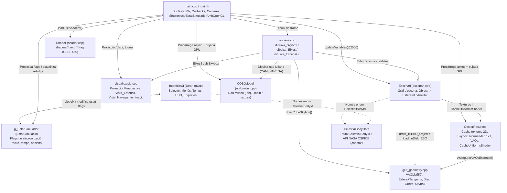
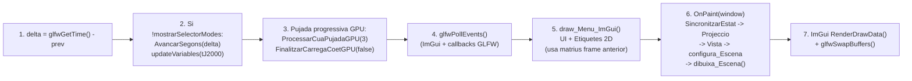

# Guia de l'Entorn i Arquitectura — Simulador del Sistema Solar

> **Projecte:** Simulador Gràfic Interactiu del Sistema Solar (VGI · UAB · ABP Grup 05)  
> **Document complementari:** Per a la cerca detallada de signatures, variables globals, camps de classes, números de línia i uniforms de shaders, consulteu la [Referència Tècnica Completa de Fitxers i Símbols](./REFERENCIA_FITXERS_I_SIMBOLS.md).

---

## Índex

1. [Visió general i stack tecnològic](#1-visió-general-i-stack-tecnològic)
2. [Entorn de compilació i dependències](#2-entorn-de-compilació-i-dependències)
3. [Estructura de directoris i mapa de fitxers](#3-estructura-de-directoris-i-mapa-de-fitxers)
4. [Arquitectura de mòduls i comunicació](#4-arquitectura-de-mòduls-i-comunicació)
5. [Cicle de vida i flux d'execució frame a frame](#5-cicle-de-vida-i-flux-dexecució-frame-a-frame)
6. [Graf d'escena, simulació orbital i efemèrides (CSPICE)](#6-graf-descena-simulació-orbital-i-efemèrides-cspice)
7. [Pipeline de renderitzat, il·luminació i shaders](#7-pipeline-de-renderitzat-illuminació-i-shaders)
8. [Gestió de recursos, precàrrega asíncrona i models 3D](#8-gestió-de-recursos-precàrrega-asíncrona-i-models-3d)
9. [Interfície d'usuari (Dear ImGui), càmeres i controls](#9-interfície-dusuari-dear-imgui-càmeres-i-controls)
10. [Guia ràpida: «On tocar si vull fer...?»](#10-guia-ràpida-on-tocar-si-vull-fer)
11. [Estat actual d'implementació i notes tècniques conegudes](#11-estat-actual-dimplementació-i-notes-tècniques-conegudes)

---

## 1. Visió general i stack tecnològic

L'aplicació és un simulador gràfic interactiu del Sistema Solar desenvolupat en **C++** sobre l'entorn docent **EntornVGI** (UAB), migrat i adaptat a **OpenGL 4.6 Core Profile** amb interfície moderna en **Dear ImGui**.

| Component | Tecnologia / Versió | Funció dins del projecte |
|---|---|---|
| **Llenguatge i compilador** | C++ (MSVC `v145`, Visual Studio 2022/2026, `/utf-8`) | Lògica d'aplicació, graf d'escena i motor gràfic |
| **API Gràfica** | OpenGL 4.6 Core + **GLEW** | Renderitzat programable (VAO/VBO/EBO, shaders GLSL 460, debug output, MSAA x4) |
| **Finestra i entrada** | **GLFW 3.4** (`include/GLFW/`) | Creació de finestra, context OpenGL, teclat, ratolí, roda i temps (`glfwGetTime`) |
| **Interfície gràfica** | **Dear ImGui v1.89.4 WIP** (`include/ImGui/`) | Selector de modes, barra superior, panell de temps/timelapse, HUD astronòmic i etiquetes 2D |
| **Matemàtiques 3D** | **GLM** (`include/glm/`) | Vectors, matrius `mat3`/`mat4`, projecció perspectiva, `lookAt`, `project` |
| **Càrrega d'imatges** | **SOIL2** (`include/gl/SOIL2.h`, `lib/x64/soil2.lib`) | Descodificació a RAM i càrrega de textures 2D, mapes normals i cubemaps |
| **Efemèrides astronòmiques** | **NASA CSPICE** (`include/cspice/`, `lib/x64/cspice.lib`, `cbdata/`) | Kernels JPL DE440, Plutó, 300 asteroides, Halley i Voyager 1/2 *(mòdul preparat a `CelestialBodyData`, pendent de connectar a `Escenari`)* |
| **Diàlegs natius** | **NFD** (`include/ImGui/nfd.h`, `lib/x64/nfd_d.lib`) | Enllaçat al projecte (llegat d'EntornVGI per obrir fitxers) |

---

## 2. Entorn de compilació i dependències

- **Solució:** [EntornVGI.slnx](../Entorn-GLFW-GL4.6-ImGui/EntornVGI.slnx)
- **Projecte Visual Studio:** [EntornVGI.vcxproj](../Entorn-GLFW-GL4.6-ImGui/EntornVGI/EntornVGI.vcxproj) i [EntornVGI.vcxproj.filters](../Entorn-GLFW-GL4.6-ImGui/EntornVGI/EntornVGI.vcxproj.filters)
- **Arquitectura recomanada i suportada:** **`x64`** (`Debug|x64` o `Release|x64`).
  - Les configuracions `Win32` no tenen `AdditionalIncludeDirectories` (`..\include`) ni `cspice.lib` (que només existeix a `lib\x64\`).
- **Configuració clau a `Debug|x64` i `Release|x64`:**
  - `AdditionalIncludeDirectories`: `..\include`
  - `AdditionalLibraryDirectories`: `..\lib\x64`
  - `AdditionalDependencies`:
    - `Debug|x64`: `cspice.lib;glfw3dll.lib;opengl32.lib;glew32.lib;glew32s.lib;SOIL2.lib;nfd_d.lib`
    - `Release|x64`: `cspice.lib;glfw3.lib;opengl32.lib;glew32.lib;glew32s.lib;SOIL2.lib;nfd_d.lib`
  - `AdditionalOptions`: `/utf-8` (necessari per als literals en català amb accents i símbols a `InterficieUI.cpp` i consola Windows UTF-8).
  - **Post-Build Event:** copia automàticament `..\lib\x64\*.dll` (`glew32.dll`, `glfw3.dll`) a `$(OutDir)`.
- **Directori de treball en execució:** ha de ser `Entorn-GLFW-GL4.6-ImGui\EntornVGI\` perquè totes les rutes relatives (`shaders/...`, `textures/...`, `cbdata/...`) es resolen respecte a aquesta carpeta.

---

## 3. Estructura de directoris i mapa de fitxers

### 3.1 Arbre del repositori

```text
SISTEMA-SOLAR-VGI/
├── README.md                                # Descripció general, equip (Grup 05) i compilació
├── docs/                                    # Documentació funcional, tècnica i catàlegs
│   ├── GUIA_ARQUITECTURA_ENTORN.md          # (Aquest document) Guia global de l'entorn i arquitectura
│   ├── REFERENCIA_FITXERS_I_SIMBOLS.md      # Inventari complet de fitxers, funcions, structs i shaders
│   ├── REQUISITS_PRINCIPALS.md              # Abast, requisits funcionals (RF-01..RF-12) i no funcionals
│   ├── Casos d'Ús_ Simulador del Sistema Solar.md
│   ├── actes/                               # Actes ABP 1..7 en PDF
│   └── planetes/                            # Catàleg astronòmic de referència (planetes.json + textures font)
└── Entorn-GLFW-GL4.6-ImGui/
    ├── EntornVGI.slnx                       # Solució Visual Studio
    ├── include/                             # Capçaleres de tercers: cspice/, gl/, GLFW/, glm/, ImGui/
    ├── lib/                                 # Llibreries estàtiques i DLLs (Win32/ i x64/)
    └── EntornVGI/                           # Codi font C++, shaders i recursos runtime
        ├── main.h / main.cpp                # Punt d'entrada, bucle principal, GLFW, càmeres i sincronització UI↔GL
        ├── constants.h                      # Constants globals, macros i structs base (CColor, CEsfe3D, CVAO, LLUM...)
        ├── framework.h                      # Capçalera comuna d'includes externs i pragmes MSVC
        ├── InterficieUI.h / .cpp            # Tota la interfície Dear ImGui i struct EstatSimulacio
        ├── escenari.h / .cpp                # Graf d'escena del Sistema Solar (Object, EsferaInt, AnellInt, Escenari)
        ├── escena.h / .cpp                  # Dibuix d'eixos, skybox, dispatch d'Escenari i nau Milano
        ├── visualitzacio.h / .cpp           # Projecció perspectiva, Vista_Esferica/Navega, Iluminacio, SOIL2
        ├── GestorRecursos.h / .cpp          # Cache compartit de textures/VAOs, precàrrega multi-fil i cache d'uniforms
        ├── CelestialBodyData.h / .cpp       # Enum CelestialBodyId i embolcall NASA CSPICE (efemèrides i rotacions)
        ├── objLoader.h / .cpp               # Carregador Wavefront OBJ/MTL v3.0 amb cache binària .mbin i precàrrega CPU
        ├── shader.h / .cpp                  # Compilació, enllaç i enviament d'uniforms de programes GLSL
        ├── material.h / .cpp                # Enviament de propietats de material als shaders
        ├── glut_geometry.h / .cpp           # Primitives VAO/VBO/EBO (esfera amb tangents, disc/anell, corbes Hermitte...)
        ├── quatern.h / .cpp                 # Àlgebra i interpolació de quaternions (llegat EntornVGI)
        ├── shaders/                         # 14 fitxers GLSL (7 programes: eixos, skybox, phong, normal_mapping, flat, gouraud, inst)
        ├── textures/                        # Textures runtime: sun/, planet/, skybox/, coet/ (milano_gotg.obj/.mbin/.mtl/texture-1.png)
        ├── cbdata/                          # Kernels binaris/text de NASA SPICE (.bsp, .tls, .tpc) i SUMMARY.txt
        └── Assets/rock/                     # Model/textures de roca (rock.png, NormalMapRock.png, rock.mtl) no integrat encara
```

### 3.2 Mapa de responsabilitats dels fitxers font (`EntornVGI/`)

| Fitxer(s) | Línies | Classificació | Responsabilitat principal |
|---|---:|---|---|
| [main.h](../Entorn-GLFW-GL4.6-ImGui/EntornVGI/main.h) / [main.cpp](../Entorn-GLFW-GL4.6-ImGui/EntornVGI/main.cpp) | 188 / 2159 | **Base + Sistema Solar** | Inicialització GLFW/GLEW/ImGui, globals del motor, bucle principal, sincronització `EstatSimulacio` ↔ OpenGL, precàrrega coet, càmeres i callbacks d'entrada. |
| [InterficieUI.h](../Entorn-GLFW-GL4.6-ImGui/EntornVGI/InterficieUI.h) / [InterficieUI.cpp](../Entorn-GLFW-GL4.6-ImGui/EntornVGI/InterficieUI.cpp) | 269 / 2117 | **Sistema Solar** | Estat únic de simulació (`EstatSimulacio`), estil/fonts catalanes, selector modal, barra de menú per mode, control de temps/timelapse, fitxa HUD i etiquetes 2D. |
| [escenari.h](../Entorn-GLFW-GL4.6-ImGui/EntornVGI/escenari.h) / [escenari.cpp](../Entorn-GLFW-GL4.6-ImGui/EntornVGI/escenari.cpp) | 276 / 522 | **Sistema Solar** | Graf d'escena jeràrquic (`Object`, `EsferaInt`, `AnellInt`), contenidor `Escenari`, òrbites circulars, normal mapping per esfera i llista ordenada d'objectes enfocables. |
| [GestorRecursos.h](../Entorn-GLFW-GL4.6-ImGui/EntornVGI/GestorRecursos.h) / [GestorRecursos.cpp](../Entorn-GLFW-GL4.6-ImGui/EntornVGI/GestorRecursos.cpp) | 108 / 489 | **Sistema Solar** | Cache compartit de textures 2D, normal map 1×1 per defecte, cubemap Skybox, VAOs compartits (`GLU_SPHERE`, `GLUT_TORUS`), precàrrega asíncrona en fil secundari i `CacheUniformsShader`. |
| [CelestialBodyData.h](../Entorn-GLFW-GL4.6-ImGui/EntornVGI/CelestialBodyData.h) / [CelestialBodyData.cpp](../Entorn-GLFW-GL4.6-ImGui/EntornVGI/CelestialBodyData.cpp) | 78 / 191 | **Sistema Solar** | Enum d'IDs NAIF (`CelestialBodyId`), catàleg SPICE (`cbList`), càrrega de kernels (`cbdata/`) i consulta d'estats/rotacions/òrbites osculatrius amb CSPICE. |
| [escena.h](../Entorn-GLFW-GL4.6-ImGui/EntornVGI/escena.h) / [escena.cpp](../Entorn-GLFW-GL4.6-ImGui/EntornVGI/escena.cpp) | 33 / 196 | **Base + Sistema Solar** | Dibuix d'eixos (`dibuixa_Eixos`), skybox (`dibuixa_Skybox`), invocació a `Escenari::dibuixaEscenari` i transformació/dibuix de la nau Milano (`dibuixa_EscenaGL`). |
| [visualitzacio.h](../Entorn-GLFW-GL4.6-ImGui/EntornVGI/visualitzacio.h) / [visualitzacio.cpp](../Entorn-GLFW-GL4.6-ImGui/EntornVGI/visualitzacio.cpp) | 49 / 751 | **Base EntornVGI** | `Projeccio_Perspectiva`, `Vista_Esferica`, `Vista_Navega`, `Iluminacio` (8 llums), `instancia`, `deixos`/`draw_Eixos`, `Fons` i carregadors síncrons SOIL2 (`loadIMA_SOIL`, `loadCubemap`). |
| [objLoader.h](../Entorn-GLFW-GL4.6-ImGui/EntornVGI/objLoader.h) / [objLoader.cpp](../Entorn-GLFW-GL4.6-ImGui/EntornVGI/objLoader.cpp) | 155 / 1135 | **Base optimitzada (v3.0)** | Carregador `.obj`/`.mtl` d'una passada amb caché binària `.mbin`, precàrrega CPU thread-safe (`LoadToCPU`/`UploadFromCPU`) i renderitzat indexat VBO+EBO (usat per la nau Milano). |
| [shader.h](../Entorn-GLFW-GL4.6-ImGui/EntornVGI/shader.h) / [shader.cpp](../Entorn-GLFW-GL4.6-ImGui/EntornVGI/shader.cpp) | 73 / 571 | **Base EntornVGI** | Classe `Shader`: lectura de fitxers GLSL, compilació, enllaç, registre d'errors (`GLSL_Error.*`) i setters d'uniforms. |
| [glut_geometry.h](../Entorn-GLFW-GL4.6-ImGui/EntornVGI/glut_geometry.h) / [glut_geometry.cpp](../Entorn-GLFW-GL4.6-ImGui/EntornVGI/glut_geometry.cpp) | 2925 / ~9600 | **Base + Extensions** | Registre global `VAOList[50]` i generadors de primitives. **Extensions del projecte:** `loadgluSphere_EBO` amb tangents (`location 4`), `loadgluPartialDisk_EBO` amb UVs polars per a anells i corbes Hermitte amb `CState3D`. |
| [material.h](../Entorn-GLFW-GL4.6-ImGui/EntornVGI/material.h) / [material.cpp](../Entorn-GLFW-GL4.6-ImGui/EntornVGI/material.cpp) | 21 / 109 | **Base EntornVGI** | `SeleccionaColorMaterial`: envia `sw_intensity`, `sw_material` i `material.*` als shaders. |
| [constants.h](../Entorn-GLFW-GL4.6-ImGui/EntornVGI/constants.h) | 218 | **Base + Sistema Solar** | Constants globals, structs (`CColor`, `CEsfe3D`, `CVAO`, `LLUM`, `MATERIAL`...), més `SISTEMA_SOLAR`, `NORMAL_MAP_SHADER` i `p_far = 50000.0`. |
| [framework.h](../Entorn-GLFW-GL4.6-ImGui/EntornVGI/framework.h) | 58 | **Base EntornVGI** | Agrupa `<gl/glew.h>`, `<GLFW/glfw3.h>`, GLM, `"glut_geometry.h"`, `"gl/SOIL2.h"`, `<vector>`, `<string>` i `"constants.h"`. |
| [quatern.h](../Entorn-GLFW-GL4.6-ImGui/EntornVGI/quatern.h) / [quatern.cpp](../Entorn-GLFW-GL4.6-ImGui/EntornVGI/quatern.cpp) | 61 / 827 | **Llegat EntornVGI** | Llibreria d'operacions i interpolació (Lerp/Slerp) amb `GL_Quat` (inclosa a `visualitzacio.cpp`, sense ús actiu al simulador). |

---

## 4. Arquitectura de mòduls i comunicació

### 4.1 Diagrama d'arquitectura



### 4.2 Patrons de comunicació entre mòduls

1. **Estat únic compartit UI ↔ Motor (`g_EstatSimulador`)**:
   - `InterficieUI` no executa crides OpenGL directes sobre l'escena; es limita a mutar `EstatSimulacio g_EstatSimulador` (`main.cpp:33`) i activar flags booleans:
     - `configuracioInicialPendent`: primera entrada des del selector de modes.
     - `canviModeDirectePendent`: commutació en directe entre `INTUITIU` (`escenaris[0]`) i `ESCALA_REAL` (`escenaris[1]`).
     - `recalculEfemeridesNecessari`: força un `updateVariables(..., forcarActualitzacio=true)` quan l'usuari canvia la data/hora manualment (fins i tot en pausa).
     - `canviCameraPendent`: reposiciona `OPV` o commuta a `CAM_NAVEGA`.
   - `main.cpp::SincronitzarEstatSimuladorAmbOpenGL()` consumeix i neteja aquests flags al principi de cada `OnPaint()`.
2. **Dades de CPU cap als shaders sense lectures GPU (`ParametresIluminacioEscenari` + `CacheUniformsShader`)**:
   - En lloc de consultar el driver OpenGL amb `glGetUniformLocation` o `glGetUniformfv` cada frame, `dibuixa_Escena()` empaqueta `ProjectionMatrix`, `llumGL[8]`, `llum_ambient` i `ifixe` dins `ParametresIluminacioEscenari` i ho passa a `Escenari::dibuixaEscenari()`, que utilitza dos `CacheUniformsShader` estàtics (`s_cachePhong` i `s_cacheNormalMap`).
3. **Estat de la nau Milano (`extern`)**:
   - `posMilano`, `angleMilano` i `inclinacioMilano` es defineixen a `main.cpp:36-39`, es modifiquen pels callbacks d'entrada (`Teclat_Navega`, `OnMouseMove`) i es llegeixen com a `extern` des d'`escena.cpp` (`escena.h:29-31`) per construir la matriu de model del coet.

---

## 5. Cicle de vida i flux d'execució frame a frame

### 5.1 Arrencada (`main()`, `main.cpp:1890-2049`)

1. **Consola i finestra:** activa UTF-8 a la consola Windows (`SetConsoleOutputCP`/`SetConsoleCP`), inicialitza GLFW, demana MSAA x4 (`GLFW_SAMPLES = 4`), crea la finestra `1280×720` i el context OpenGL.
2. **GLEW i depuració GL 4.6:** inicialitza GLEW (`glewExperimental = GL_TRUE`), consulta versió OpenGL (`GetGLVersion`), habilita `GL_MULTISAMPLE` i registra `glDebugOutput` si el context té `GL_CONTEXT_FLAG_DEBUG_BIT`.
3. **Estat base i shaders (`InitGL()`, `main.cpp:41-329`):** inicialitza totes les globals heretades d'EntornVGI (càmera, 8 llums `llumGL[0..7]`, materials), crida `initVAOList()`, compila els 4 shaders actius (`eixos`, `skybox`, `phong_shdrML`, `normal_mapping`) i construeix el VAO del cub Skybox (`loadCubeSkybox_VAO()`).
4. **Callbacks GLFW:** registra `OnSize` (window i framebuffer), `OnMouseButton`, `OnMouseMove`, `OnMouseWheel`, `OnKeyDown`, `error_callback` i `OnPaint`.
5. **Dear ImGui:** crea el context ImGui, aplica tema fosc i fonts catalanes (`InterficieUI::InicialitzarEstil()`) i inicialitza `ImGui_ImplGlfw_InitForOpenGL(window, true)` (que encadena els seus wrappers davant dels callbacks anteriors) + `ImGui_ImplOpenGL3_Init("#version 130")`.
6. **Reserva d'escenaris i precàrrega en segon pla:** reserva `escenaris = new Escenari[2]` (sense poblar-los encara mentre el selector inicial de modes està obert) i llança dos fils en paral·lel:
   - `IniciarPrecarregaCoet()` → descodifica `textures/coet/milano_gotg.obj` (o `.mbin`) i `texture-1.png` a RAM.
   - `GestorRecursos::IniciarPrecarregaEscena()` → descodifica les 6 cares del Skybox i les 18 textures planetàries/normal maps a RAM.

### 5.2 Bucle principal per fotograma (`main.cpp:2051-2114`)



> **Detall important d'ordre:** `draw_Menu_ImGui()` (pas 5) s'executa **abans** d'`OnPaint()` (pas 6). Per tant, les etiquetes 2D projectades amb `glm::project` usen la `ViewMatrix` i `ProjectionMatrix` del fotograma immediatament anterior, i els canvis fets a la UI al frame `N` es sincronitzen amb OpenGL en el pas 6 del mateix frame `N`.

### 5.3 Tancament i alliberament de recursos (`main.cpp:2121-2148`)

1. Tancament d'ImGui (`ImGui_ImplOpenGL3_Shutdown`, `ImGui_ImplGlfw_Shutdown`, `DestroyContext`).
2. `delete[] escenaris;` → destrueix cada `Escenari` (`alliberaEscenari()` elimina tots els `Object` arrel i recursivament els fills; els `AnellInt` alliberen el seu propi VAO, mentre que les textures compartides no s'esborren perquè `m_propietariTextures == false`).
3. Espera i neteja de la nau Milano (`g_coetPreloadThread.join()`, `COBJModel::FreePreloadData`, `delete ObOBJ`).
4. `GestorRecursos::AlliberarTot()` → cancel·la el fil de precàrrega, allibera buffers CPU, destrueix totes les textures OpenGL (`s_cacheTextures2D`, `s_defaultNormalMapID`, `s_cubemapID`) i elimina els VAOs compartits (`GLU_SPHERE`, `GLU_DISK`, `GLUT_TORUS`, `CUBE_SKYBOX`) **abans** de destruir la finestra.
5. `glfwDestroyWindow(window)` i `glfwTerminate()`.

---

## 6. Graf d'escena, simulació orbital i efemèrides (CSPICE)

### 6.1 Jerarquia de classes d'`Escenari` (`escenari.h/.cpp`)

- **`Object`** (classe base abstracta, no copiable): conté `m_trMatrix` (posició/transformació global precalculada), `m_scale` (radi per a la càmera), `m_id` (`CelestialBodyId`), `m_categoria` (`CategoriaObjecte`), `m_enfocable`, `m_mostrarEtiqueta`, `m_ordreMenu`, textures (`m_textureID`, `m_normalMapID`, `m_propietariTextures`), `m_parent`, `m_sons` i `m_sw_mat[5]`.
- **`EsferaInt : public Object`**: cos esfèric amb òrbita circular uniforme inclinada (`m_radiOrbita`, `m_angleOrbitaInicial`, `m_velAngular`, `m_inclinacioOrbita`) i rotació axial (`m_angleRotacioInicial`, `m_velRotacio`, `m_inclinacioEix`).
  - A `update(tempsJ2000, matriuPare)`: calcula `m_angleOrbita = fmod(inicial + velAngular * tempsJ2000, 360)` (normalitzat a `[0, 360)`), calcula la posició sobre el pla orbital inclinat entorn de X i construeix `m_trMatrix` conservant l'orientació del pare i substituint la columna de translació `m_trMatrix[3]`.
  - A `drawObject(ctx, matriuPare)`: dibuixa primer el cercle d'òrbita (`GLUT_TORUS` com `GL_LINE_LOOP` amb `shaderPhongID`), després aplica inclinació axial + rotació pròpia + escalat per dibuixar `GLU_SPHERE` amb `shaderNormalMapID`, i finalment propaga recursivament als fills `m_sons`.
- **`AnellInt : public Object`**: disc pla perforat (`m_radiIntern`, `m_radiExtern`, `m_inclinacioEix`) de categoria `ORNAMENTAL` (`m_enfocable = false`, `m_mostrarEtiqueta = false`). Crea el seu propi `CVAO m_vao` mitjançant `loadgluDisk_EBO(m_radiIntern, m_radiExtern, 80, 5)` i el renderitza amb `shaderPhongID`, `sw_twoSided = GL_TRUE`, `GL_BLEND` i `glDepthMask(GL_FALSE)`.
- **`Escenari`**: emmagatzema tots els objectes direccionables a `std::unordered_map<CelestialBodyId, Object*> m_objectList` per accés directe `O(1)` via `obtenirObjecte(id)`.

### 6.2 Cossos instanciats actualment a `Escenari::creaEscenari()` (`escenari.cpp:318-413`)

L'arbre del graf d'escena té `CB_SUN` com a únic node arrel; els 8 planetes són fills del Sol, `CB_MOON` és fill de `CB_EARTH` i `AnellInt` és fill de `CB_SATURN` (fora de `m_objectList`).

| ID (`CelestialBodyId`) | Nom | Pare | Categoria | Ordre menú | Radi cos | Radi òrbita | Període orb. (dies) | Vel. rot. (°/dia) | Incl. eix (°) | Incl. òrb. (°) | Normal Map |
|---|---|---|---|---:|---:|---:|---:|---:|---:|---:|---|
| `CB_SUN` | Sol | *(arrel)* | `ESTRELLA` | 0 | 16.0 | 0.0 | ∞ | 14.184 | 0.00 | 0.00 | Defecte 1×1 |
| `CB_MERCURY` | Mercuri | Sol | `PLANETA` | 10 | 2.0 | 27.0 | 87.97 | 6.136 | 0.03 | 7.00 | Real |
| `CB_VENUS` | Venus | Sol | `PLANETA` | 20 | 3.5 | 40.0 | 224.70 | 1.481 | 177.36 | 3.39 | Real |
| `CB_EARTH` | Terra | Sol | `PLANETA` | 30 | 3.7 | 55.0 | 365.256 | 361.015 | -23.44 | 0.00 | Real |
| `CB_MOON` | Lluna | Terra | `SATELLIT_NATURAL` | 31 | 1.0 | 7.0 | 27.322 | 360/27.322 | 6.68 | 5.14 | Defecte 1×1 |
| `CB_MARS` | Mart | Sol | `PLANETA` | 40 | 2.8 | 70.0 | 686.98 | 351.220 | 25.19 | 1.85 | Real |
| `CB_JUPITER` | Júpiter | Sol | `PLANETA` | 50 | 9.0 | 105.0 | 4332.59 | 871.249 | 3.13 | 1.30 | Real |
| `CB_SATURN` | Saturn | Sol | `PLANETA` | 60 | 7.5 | 140.0 | 10759.2 | 818.182 | 26.73 | 2.49 | Real |
| *(sense ID)* | Anells de Saturn | Saturn | `ORNAMENTAL` | — | 9.0..17.5 | — | — | — | 26.73 | — | Defecte 1×1 |
| `CB_URANUS` | Urà | Sol | `PLANETA` | 70 | 5.5 | 175.0 | 30688.5 | 501.393 | 97.77 | 0.77 | Defecte 1×1 |
| `CB_NEPTUNE` | Neptú | Sol | `PLANETA` | 80 | 5.3 | 210.0 | 60195.0 | 545.455 | 28.32 | 1.77 | Real |

> **Radi de referència del sistema:** `Escenari::obtenirRadiReferenciaSistema()` retorna `210.0` (òrbita de Neptú), usat per reescalar la càmera global i la posició de la nau Milano quan es canvia de mode.

### 6.3 Modes de simulació i integració amb NASA CSPICE

- **Estat real dels dos modes (`escenaris[0]` vs `escenaris[1]`):**
  - `InterficieUI` i `main.cpp` ja suporten la commutació completa entre `ModeSimulacio::INTUITIU` (`&escenaris[0]`) i `ModeSimulacio::ESCALA_REAL` (`&escenaris[1]`), conservant el ràtio de zoom relatiu, la càmera, la data i el focus (`EstatVistaTransicio`).
  - Tot i això, a `main.cpp:2033` `escenaris = new Escenari[2]` instancia **dues còpies de la mateixa classe `Escenari`** (òrbites circulars didàctiques), i `Escenari::updateVariables()` descarta els paràmetres `escalaReal` i `factorVelocitat` (`escenari.cpp:490-493`).
- **Mòdul d'efemèrides CSPICE (`CelestialBodyData.h/.cpp` + `cbdata/`):**
  - El codi per carregar els 9 kernels de `cbdata/` (`loadCspiceKernels()`) i obtenir posicions/velocitats (`getCBstate`, `getCBposMat` en marc **`J2000`**), rotacions IAU (`getCBrotMat` via `pxform_c`) i òrbites osculatrius (`getOrbitStates` en UA via `oscltx_c`) està implementat i compila contra `cspice.lib`.
  - **Encara no és invocat** ni des de `main.cpp` ni des d'`escenari.cpp` (aquests mòduls només n'importen `enum CelestialBodyId`, i `glut_geometry` n'importa `CState3D` per a les corbes d'Hermitte).
  - La conversió de data/hora del simulador a segons TDB des de J2000.0 ja existeix a `main.cpp::toJ2000Seconds()` (`L1869-1887`).

---

## 7. Pipeline de renderitzat, il·luminació i shaders

### 7.1 Ordre de dibuix per frame (`OnPaint` → `dibuixa_Escena`)

1. **Projecció (`Projeccio_Perspectiva`)**: `FOV = 60°`, `p_near = 0.01`, `p_far = 50000.0`.
2. **Vista (`Vista_Esferica` / `Vista_Navega`)**:
   - En `CAM_ESFERICA`: calcula `lookAt` en coordenades esfèriques `(R, alfa, beta)` amb `POLARZ`, i després aplica `glm::translate(ViewMatrix, -posObjecte)` amb la posició del cos enfocat (`m_trMatrix[3]`) per centrar-lo sense retard de fotograma.
   - En `CAM_NAVEGA`: neteja buffers i sobreescriu `ViewMatrix` amb una càmera en 3a persona darrere la nau Milano (`posMilano - dir * 35 + (0,0,5)` mirant a `posMilano + dir * 8 + (0,0,2)`).
3. **Skybox (`dibuixa_Skybox`, shader `skybox`)**: elimina la translació de `ViewMatrix` (`mat4(mat3(ViewMatrix))`), rota `+90°` en X per `POLARZ`, escala `5000`, fixa profunditat a `1.0` (`pos.xyww`) amb `GL_LEQUAL` i `glDepthMask(GL_FALSE)`.
4. **Eixos de guia (`dibuixa_Eixos`, shader `eixos`)**: si `eixos == true`, dibuixa 3 línies de longitud 300 (X vermell, Y verd, Z cian).
5. **Sistema Solar (`Escenari::dibuixaEscenari`)**:
   - Sincronitza projecció, vista, `normalMatrix` i llums al shader `normal_mapping` directament des de CPU (`SincronitzarShaderNormalMap`).
   - Recorre el graf d'escena alternant només quan cal (`activarShaderSiCal`):
     - **Òrbites** → `phong_shdrML` (emissiu pur, `GL_LINE_LOOP`, `VAOList[GLUT_TORUS]`).
     - **Esferes (Sol, planetes, Lluna)** → `normal_mapping` (`GL_TEXTURE0` albedo, `GL_TEXTURE1` normal map, força de relleu `0.3`, `VAOList[GLU_SPHERE]`, `uNormalMatrixPV` precalculada a CPU).
     - **Anells de Saturn** → `phong_shdrML` (`sw_twoSided = GL_TRUE`, `GL_BLEND`, `glDepthMask(GL_FALSE)`, `AnellInt::m_vao`).
6. **Nau Milano (`dibuixa_EscenaGL`, shader `phong_shdrML`)**: només visible quan `camera == CAM_NAVEGA` (`mostrarMilano == true`). Activa `GL_CULL_FACE` (`GL_BACK`), compensa el centre geomètric `(5.05, 0.71, -7.55)` i dibuixa `ObOBJ->draw_TriVAO_OBJ(sh_programID)`.
7. **Interfície i Etiquetes 2D (`ImGui_ImplOpenGL3_RenderDrawData`)**: superposa els panells ImGui i les etiquetes al viewport.

### 7.2 Sistema d'il·luminació

- **Llum solar principal (`llumGL[0]`):** llum puntual fixa (`fixedLight = true`) a `(0, 0, 0, 1)` (centre del Sol), difusa i especular blanques `(1,1,1,1)` i atenuació quadràtica `a = 0.00004, b = 0, c = 1`.
- **Sol autoemissiu:** `CB_SUN` té `m_sw_mat[0] = true` (canal emissiu actiu quan `iluminacioSolarDirecta == true`).
- **Vista Clara (`vistaClaraAmbient`):** activa `llum_ambient` (`LightModelAmbient = (0.5, 0.5, 0.5, 1.0)`) i `sw_material[1]` per veure també la cara nocturna dels planetes.
- **Il·luminació bilateral (`sw_twoSided`):** usada als anells de Saturn per evitar que una cara quedi negra (`0.35 + 0.65 * abs(dot(L, N))`).

### 7.3 Resum dels 7 programes GLSL (`shaders/`)

| Programa | Fitxers | Estat | Atributs (`location`) | Unitats de textura | Ús real |
|---|---|---|---|---|---|
| **Eixos** | `eixos.vert`, `eixos.frag` | Actiu | `0`: pos, `1`: color | Cap | Eixos de coordenades (X/Y/Z) |
| **Skybox** | `skybox.VERT`, `skybox.FRAG` | Actiu | `0`: pos | `0`: `skybox` (`samplerCube`) | Fons estel·lar cúbic |
| **Phong ML** | `phong_shdrML.vert`, `.frag` | Actiu | `0`: pos, `1`: color, `2`: normal, `3`: UV | `0`: `texture0` | Òrbites, anells de Saturn (`sw_twoSided`), nau Milano |
| **Normal Map** | `normal_mapping.vert`, `.frag` | Actiu | `0..3` + `4`: `in_Tangent` | `0`: `texture0`, `1`: `normalMap` | Totes les esferes (`EsferaInt`: Sol, planetes, Lluna) |
| **Flat ML** | `flat_shdrML.vert`, `.frag` | Llegat | `0..3` | `0`: `texture0` | No utilitzat al simulador |
| **Gouraud ML** | `gouraud_shdrML.vert`, `.frag` | Llegat | `0..3` | `0`: `texture0` | No utilitzat al simulador |
| **Gouraud Inst** | `gouraud_shdrML_inst.vert`, `.frag` | Incomplet | `0..3` + `4`: `????` | `0`: `texture0` | Plantilla inacabada (no compila GLSL) |

---

## 8. Gestió de recursos, precàrrega asíncrona i models 3D

### 8.1 `GestorRecursos` (Textures 2D, Skybox i VAOs compartits)

Per evitar congelar l'arrencada i no duplicar VRAM entre `escenaris[0]` i `escenaris[1]`, `GestorRecursos` implementa un pipeline productor-consumidor:

1. **Fil secundari (`IniciarPrecarregaEscena()`):** descodifica amb `SOIL_load_image` les 6 cares del Skybox (`textures/skybox/*.png`) i les 18 textures de `kTexturesPrecarrega2D` a memòria RAM (`ImatgeCPU`), protegides amb `s_mutex`.
2. **Pujada progressiva al fil OpenGL (`ProcessarCuaPujadaGPU(3)`):** cada frame mentre l'usuari mira el selector de modes puja fins a 3 textures a GPU (amb mipmaps, `GL_REPEAT`, filtrat trilineal i anisotropia `8x`) i allibera tot seguit la memòria RAM.
3. **Finalització garantida (`FinalitzarPrecarregaGPU()`):** en entrar a l'escenari, fa `join()` i buida la cua restant abans de `creaEscenari()`.
4. **Cerca en 3 nivells (`ObtenirTextura2D(ruta)`):** normalitza la ruta (`\` → `/`, treu `./`) i busca a: (1) cache GPU `s_cacheTextures2D`, (2) cua CPU pendent, (3) càrrega síncrona de disc.
5. **Recursos compartits únics:**
   - `ObtenirNormalMapPerDefecte()`: textura `1×1` plana `{128, 128, 255}` compartida pels cossos sense mapa normal.
   - `AssegurarVAOsEscenari()`: crea un sol cop `VAOList[GLU_SPHERE]` (`loadgluSphere_EBO(1.0, 40, 40)`) i `VAOList[GLUT_TORUS]` (`creaOrbita()`).
   - **Propietat:** els `Object` creats amb `GestorRecursos` tenen `m_propietariTextures = false`, i tota la neteja passa per `GestorRecursos::AlliberarTot()`.

### 8.2 Nau Milano i carregador `objLoader` v3.0 (`.obj` / `.mbin`)

`GestorRecursos` **no gestiona models `.obj`**. La nau Milano (`textures/coet/milano_gotg.obj`) té el seu propi flux asíncron a `main.cpp` sobre `COBJModel`:

1. `IniciarPrecarregaCoet()` llança `g_coetPreloadThread` que crida `COBJModel::LoadToCPU()`.
2. `LoadToCPU` comprova si existeix la cache binària **`milano_gotg.mbin`** vàlida (mateixa mida i `mtime` que l'`.obj`, capçalera `"MBIN"` versió 1). Si és vàlida, carrega directament els buffers binaris de vèrtexs (`VertexOBJ`, 32 bytes intercalats) i índexs; si no, parseja `.obj`/`.mtl` en una passada, indexa (camí directe 1:1 o hash FNV-1a) i desa `.mbin` atòmicament via `.mbin.tmp` + `MoveFileExA`. També descodifica `texture-1.png` a RAM.
3. Al bucle principal (`FinalitzarCarregaCoetGPU(false)`) o en activar `"Pilota coet"` (`AssegurarCoetCarregat()`), `COBJModel::UploadFromCPU()` puja VBO+EBO i textura a GPU en `ObOBJ`.
   - Atributs de `COBJModel`: `location 0` (posició), `location 2` (normal), `location 3` (UV). `location 1` (`in_Color`) es desactiva i s'injecta per submalla amb `glVertexAttrib4f(1, Kd...)`. No genera tangents (`location 4`).

### 8.3 `glut_geometry` i extensions pròpies del projecte

`glut_geometry.cpp` manté l'array global `CVAO VAOList[50]` amb VBOs per blocs contigus de `GL_DOUBLE` (excepte el Skybox en `GL_FLOAT`). Les 3 extensions específiques del Sistema Solar són:
- **`loadgluSphere_EBO(1.0, 40, 40)`**: calcula tangents per vèrtex per triangle, ortogonalitza per Gram-Schmidt, resol degeneracions als pols i les puja a `layout(location = 4)` mitjançant `load_TRIANGLES_EBOver2()`.
- **`loadgluPartialDisk_EBO` / `loadgluDisk_EBO`**: genera coordenades de textura polars (`u` radial `0..1`, `v` angular `0..1`) adaptades a la textura d'anells `2k_saturn_ring_alpha.png`.
- **`load_Hermitte_Curve_VAO/EBO(..., CState3D[])`**: sobrecàrregues que construeixen corbes d'òrbita a partir d'estats posició+velocitat `CState3D` de `CelestialBodyData.h`.

---

## 9. Interfície d'usuari (Dear ImGui), càmeres i controls

### 9.1 Components visuals de `InterficieUI`

- **Estil i fonts (`InicialitzarEstil`):** tema espacial fosc amb resplendor cian i 5 mides de tipografia (`Segoe UI` / fallback `Arial`) amb rang complet de glifs catalans (`ÀÁÈÉÍÏÒÓÚÜÇàáèéíïòóúüç·•—–°²³«»¿¡€`).
- **Selector Inicial de Modes (`DibuixarSelectorInicialModes`):** modal responsive a pantalla completa amb 2 targetes (`Mode Didàctic` → `escenaris[0]`, `Mode a Escala Real` → `escenaris[1]`). Bloqueja el renderitzat 3D i l'entrada fins que l'usuari tria un mode.
- **Barra de Menú Superior Dinàmica (`DibuixarBarraMenuSuperior`):**
  - *Mode Didàctic (`INTUITIU`)*: `Escenari`, `Temps & Data`, `Astres & Focus`, `Càmera`, `Visualització` (inclou submenú `Anells de Saturn`), `Ajuda`.
  - *Mode Escala Real (`ESCALA_REAL`)*: `Escenari`, `Temps & Data`, `Origen & Càmeres` (unifica focus + càmera), `Visualització`, `Ajuda`.
  - *Zona dreta*: badge del mode actiu, botó compacte Pausa/Play, botó `"Canviar"` (commutació directa de mode) i indicador de FPS.
- **Panell de Control de Temps i Velocitat (`DibuixarPanellDataHoraTimelapse`):** cantonada inferior dreta. Inclou visor digital (`HH:MM:SS — DD / Mes / AAAA`), pop-ups dedicats de rellotge i calendari gregorià, botons `<<`, `|| / >`, `>>`, slider logarítmic per trams (`1 h/s` fins a `50 dies/s`) i 3 presets ràpids.
- **Fitxa Astronòmica HUD (`DibuixarFitxaAstronomicaHUD`):** cantonada superior dreta; mostra dades del catàleg `kCatalegCossos` (16 cossos) amb fallback automàtic a `Object::m_nom` i `m_categoria`.
- **Etiquetes 2D (`DibuixarEtiquetaPlaneta`):** projecta els noms sobre el viewport; oculta automàticament satèl·lits naturals no enfocats que estiguin a menys de `24 px` del planeta pare.

### 9.2 Modes de càmera i límits adaptatius

| `ModeCamera` | Càmera motor | Comportament |
|---|---|---|
| `ORBITAL_CENTRADOR` | `CAM_ESFERICA` | Òrbita lliure (`alfa` i `beta`) centrada en `cosEnfocatId`, amb `minR`/`maxR`/`pasZoom` proporcionals a `m_scale` (`CalcularLimitsCameraPerCos`). |
| `FIXA_INCLINADA_25` | `CAM_ESFERICA` | Centrada en `cosEnfocatId` amb inclinació vertical blocada a `OPV.alfa = 25°`. |
| `GLOBAL_SISTEMA` | `CAM_ESFERICA` | Vista zenital centrada a `CB_SUN` (`R = 550`, `alfa = 65°`, `beta = 0°`). |
| `COET_PRIMERA_PERSONA` | `CAM_NAVEGA` | Mode `"Pilota coet"`: assegura càrrega de la nau Milano (`ObOBJ`) i situa una càmera de persecució en 3a persona darrere `posMilano`. |

### 9.3 Mapa complet de controls i dreceres

| Entrada | Context | Acció | Ubicació al codi |
|---|---|---|---|
| `Esc` | Global (si ImGui no captura teclat) | Tanca l'aplicació | `main.cpp:1207` |
| `Espai` | Simulació activa | Pausa / reprèn el temps | `main.cpp:1217` |
| `Backspace` | Simulació activa | Inverteix sentit del temps (`+1` ↔ `-1`) | `main.cpp:1221` |
| `R` | Simulació activa | Reenquadra la càmera a l'astre enfocat actual | `main.cpp:1225` |
| `Home` | Simulació activa | Torna a `GLOBAL_SISTEMA` centrat al Sol | `main.cpp:1229` |
| `Tab` | Simulació activa | Commuta en directe entre `INTUITIU` i `ESCALA_REAL` | `main.cpp:1239` |
| `←` / `→` | `CAM_ESFERICA` | Rota azimut (`OPV.beta ± 5°`) | `main.cpp:1257-1267` |
| `↑` / `↓` | `CAM_ESFERICA` | Apropa / allunya (`OPV.R`) dins límits del cos | `main.cpp:1269-1287` |
| Arrossegar botó esquerre | `CAM_ESFERICA` | Orbita `OPV.beta` i `OPV.alfa` (en `FIXA_INCLINADA_25`, `alfa` resta a `25°`) | `main.cpp:1443-1467` |
| Roda del ratolí | `CAM_ESFERICA` | Zoom adaptatiu (`OPV.R`) dins `[lim.minR, lim.maxR]` | `main.cpp:1699-1731` |
| Arrossegar botó dret | `CAM_ESFERICA` | Zoom vertical brut dins `[p_near, p_far]` | `main.cpp:1577-1595` |
| `W`/`S` o `↑`/`↓` | `CAM_NAVEGA` (Coet) | Avança / retrocedeix `posMilano` segons `angleMilano` i `inclinacioMilano` | `main.cpp:1318-1334` |
| `A`/`D` o `←`/`→` | `CAM_NAVEGA` (Coet) | Gira la nau (`angleMilano ± 5°`) | `main.cpp:1336-1344` |
| `Q` / `E` | `CAM_NAVEGA` (Coet) | Puja / baixa verticalment (`posMilano.z ± 2.0`) | `main.cpp:1346-1352` |
| Arrossegar botó esquerre | `CAM_NAVEGA` (Coet) | Ajusta `angleMilano` i `inclinacioMilano` (`[-60°, +60°]`) | `main.cpp:1470-1490` |

---

## 10. Guia ràpida: «On tocar si vull fer...?»

| Objectiu | Fitxers i punts concrets a modificar |
|---|---|
| **Afegir un nou planeta, planeta nan o satèl·lit** | 1) Comprovar/afegir ID a `CelestialBodyId` (`CelestialBodyData.h:5-43`).<br>2) Instanciar `EsferaInt`, enllaçar-lo al pare amb `addSon()`, registrar-lo a `m_objectList` i assignar textura/normal map a `Escenari::creaEscenari()` (`escenari.cpp:318-413`).<br>3) Afegir la ruta de textura a `kTexturesPrecarrega2D[]` (`GestorRecursos.cpp:19-38`) si es vol precàrrega en segon pla.<br>4) Afegir/revisar les dades educatives a `kCatalegCossos` (`InterficieUI.cpp:50-67`). |
| **Connectar CSPICE i l'escala real a `escenaris[1]`** | 1) Cridar `loadCspiceKernels()` a l'arrencada (`main.cpp`) i `unloadCspiceKernels()` al tancament.<br>2) Crear una subclasse d'`Escenari` (o nova classe `Object` basada en `getCBstate`/`getCBrotMat`/`getOrbitStates`) i substituir `escenaris[1]` (actualment `new Escenari[2]` a `main.cpp:2033`), sobreescrivint `obtenirRadiReferenciaSistema()`. |
| **Afegir una nova textura o mapa (p. ex. núvols o llums nocturnes)** | 1) Afegir ruta a `kTexturesPrecarrega2D[]` (`GestorRecursos.cpp:19-38`).<br>2) Emmagatzemar el nou `GLuint` a `Object` (`escenari.h:112`).<br>3) Afegir la ubicació de l'`uniform` a `CacheUniformsShader` (`GestorRecursos.h:36` i `.cpp:231`).<br>4) Enllaçar a `GL_TEXTURE2` dins `EsferaInt::drawObject` (`escenari.cpp`) i afegir `uniform sampler2D` a `shaders/normal_mapping.frag`. |
| **Afegir un control o menú a la UI** | 1) Afegir el camp d'estat a `OpcionsVisualitzacio` o `EstatSimulacio` (`InterficieUI.h:169-235`).<br>2) Afegir el `MenuItem`/widget a `DibuixarBarraMenuSuperior` (`InterficieUI.cpp:864-1193`).<br>3) Sincronitzar el camp amb OpenGL dins `SincronitzarEstatSimuladorAmbOpenGL()` (`main.cpp:510-835`) o passar-lo a `dibuixa_EscenaGL()`. |
| **Afegir una drecera de teclat** | Afegir la branca a `OnKeyDown()` (`main.cpp:1200-1297`) i indicar la drecera al `MenuItem` corresponent d'`InterficieUI.cpp`. |
| **Modificar la càmera o els límits de zoom** | Límits per cos: `CalcularLimitsCameraPerCos()` (`main.cpp:478-496`). Càmera orbital/coet: `OnPaint()` (`main.cpp:866-939`), `OnMouseMove()` (`L1429-1680`) i `OnMouseWheel()` (`L1687-1759`). |
| **Canviar la il·luminació o el relleu (normal mapping)** | Llum solar i atenuació: `SincronitzarEstatSimuladorAmbOpenGL()` (`main.cpp:535-555`). Intensitat del normal map (`0.3`): `shaders/normal_mapping.frag:183`. Il·luminació bilateral d'anells: `shaders/phong_shdrML.frag:143`. |
| **Afegir un model 3D `.obj`** | Instanciar `COBJModel` (`objLoader.h`), usar `LoadToCPU()` + `UploadFromCPU()` (o `LoadModel()`) i renderitzar-lo a `dibuixa_EscenaGL()` (`escena.cpp`) amb `draw_TriVAO_OBJ(sh_programID)`. |

---

## 11. Estat actual d'implementació i notes tècniques conegudes

### 11.1 Elements declarats o presents al repositori pendents d'integració

- **CSPICE (`CelestialBodyData.cpp` + `cbdata/`):** completament implementat (9 kernels carregables, `getCBstate`, `getCBrotMat`, `getOrbitStates`), però encara no invocat en temps d'execució; `escenaris[0]` i `escenaris[1]` són dues instàncies idèntiques d'`Escenari`. `CB_VOYAGER2` és a `CelestialBodyId` però manca a `cbList`.
- **Flags de `OpcionsVisualitzacio` encara no consumits:** `mostrarMarcadorsPetits`, `mostrarCinturoAsteroides`, `mostrarPuntsLagrange` (no exposats a menús) i `anellsSaturnParticules` (exposat al menú `INTUITIU`, però `AnellInt` sempre dibuixa el disc llis).
- **Actius presents a disc no carregats:** textures de núvols/nit/especular de Terra i Venus (`textures/planet/Earth/2k_earth_{clouds,daymap,nightmap}.jpg`, `2k_earth_specular_map.tif`, `Venus/2k_venus_atmosphere.jpg`), model de roca (`Assets/rock/`), i el catàleg `docs/planetes/planetes.json` (referència documental, no llegit en runtime).
- **Picking 3D i instancing:** no implementats. `shaders/gouraud_shdrML_inst.vert:45` conté un marcador `????` i no compila GLSL.

### 11.2 Detalls i anomalies tècniques detectades a tenir presents

1. **Discrepància de signatura a `visualitzacio.h:15` vs `visualitzacio.cpp:25`:** `Iluminacio` es declara amb 9 paràmetres al `.h` (falta `GLint sh_programID`) però es defineix i crida internament amb 10 al `.cpp`.
2. **Discrepància de signatura a `quatern.h:34` vs `quatern.cpp:267`:** `MatrixToQuat` es declara amb `double pMatrix` al `.h` i `double *pMatrix` al `.cpp`.
3. **Destrucció tardana de shaders a `main.cpp:2145-2146`:** `shaderLighting.DeleteProgram()` i `shaderSkyBox.DeleteProgram()` es criden després de `glfwTerminate()`, quan el context OpenGL ja s'ha destruït (i comparen `GLuint != -1`).
4. **Càmera de la nau Milano (`main.cpp:913-917`):** `OnMouseMove` actualitza `inclinacioMilano` (`[-60°, 60°]`) i `Teclat_Navega` l'aplica al desplaçament, però la càmera de persecució a `OnPaint` calcula `direccio` només en XY amb `angleMilano`.
5. **Tecla `R` vs Menú `"Reiniciar Vista"`:** el menú posa el focus al Sol i el mode de càmera per defecte; la tecla `R` (`main.cpp:1225`) només activa `canviCameraPendent = true` conservant l'astre enfocat actual.
6. **Codi heretat d'EntornVGI amb petits bugs coneguts:**
   - `glut_geometry.cpp:9303, 9557`: `draw_LINES_EBO` i `draw_TRIANGLES_EBO` fan `glBindVertexArray(eboId)` en lloc de `vaoId` (usar sempre `draw_TriEBO_Object` / `draw_LinEBO_Object`, com ja fa `escenari.cpp`).
   - `glut_geometry.cpp:188`: `netejaVAOList()` comença a `i = 1`, ometent `CUBE_SKYBOX (0)` (per això `GestorRecursos::AlliberarTot()` crida `deleteVAOList(CUBE_SKYBOX)` explícitament).
   - `visualitzacio.cpp:489, 496-497`: `instancia()` usa `eulerAngleX` per a `tgF.VRota.z` i duplica la translació final (no afecta el simulador mentre `transf == false` i `TGF` és identitat).
   - `shader.cpp:314`: `loadFileShadersG` assigna el geometry shader a `vs` en lloc de `gs` (no s'utilitza enlloc).
   - `main.cpp:1969-1977`: alguns `glfwWindowHint` (versió/perfil/debug) es criden *després* de `glfwCreateWindow`, de manera que no afecten la finestra ja creada.
   - `main.cpp:1100`: `OnCameraNavega()` escriu `tr_cpvF.x = 0.0` dues vegades en lloc de `tr_cpvF.z`.
