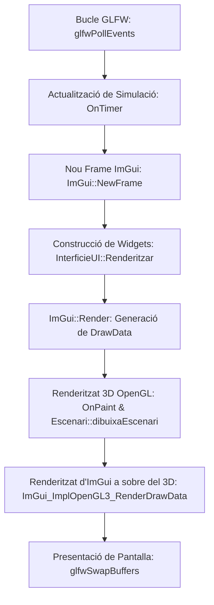

# Guia d'Implementació de la Interfície d'Usuari (Dear ImGui) en C++ i OpenGL 4.6

> **Entorn tecnològic:** C++, OpenGL 4.6 (Core Profile), GLFW 3.4, GLEW, Dear ImGui v1.89.4 WIP, GLM  
> **Ubicació del projecte:** `Entorn-GLFW-GL4.6-ImGui/EntornVGI/`  
> **Objectiu del document:** Proporcionar les especificacions tècniques, l'arquitectura de programari i el codi complet C++ per a la implementació de tots els elements d'interfície d'usuari del simulador del Sistema Solar: el **selector inicial de modes** (dos quadrats centrals), la **barra de menú superior dinàmica** filtrada per mode, el **selector de data/hora i control de timelapse** (cantonada inferior dreta) i la seva integració amb el bucle principal de l'aplicació i la classe **`Escenari`**.

---

## 1. Arquitectura i Principis de Disseny de la Interfície

### 1.1. Paradigma d'Immediat Mode (Dear ImGui)
Dear ImGui funciona sota el paradigma de **mode immediat** (*Immediate Mode GUI*):
* La interfície no emmagatzema una jerarquia d'arbres de widgets persistents a la memòria de l'aplicació.
* A cada fotograma (*frame*), la interfície es descriu proceduralment en codi C++ dins del bucle principal de renderitzat.
* La interacció de l'usuari (accions sobre botons, lliscadors, selectors o camps de text) actualitza directament les variables d'estat de la simulació en el mateix cicle d'execució.

### 1.2. Estructuració del Subsistema d'Interfície
Per mantenir un disseny modular i desacoblat de `main.cpp`, tota la lògica d'interfície s'encapsula en dos fitxers dedicats dins del projecte:
* **`InterficieUI.h`**: Declaració de tipus, estructures d'estat (`ModeSimulacio`, `DataHoraSimulacio`, `EstatTempsSimulacio`, `OpcionsVisualitzacio`, `CameraConfig`, `EstatSimulacio`) i mètodes estàtics de renderitzat.
* **`InterficieUI.cpp`**: Implementació dels panells, menús dinàmics, selectors i widgets gràfics.

### 1.3. Esquema d'Integració amb el Bucle Principal
L'ordre estricte d'execució a cada fotograma és el següent:



> [!IMPORTANT]
> El renderitzat dels comandaments de vèrtexs d'ImGui (`ImGui_ImplOpenGL3_RenderDrawData`) s'ha d'executar sempre **després** del dibuix de l'escena 3D (`OnPaint`). D'aquesta manera, els menús i panells es superposen a la vista tridimensional sense ser esborrats pel netejat de buffers (`glClear`).

---

## 2. Especificació Tècnica dels Components d'Interfície

### 2.1. Selector Inicial de Modes (Modal Central amb 2 Quadrats)

#### Comportament i Requisits
1. **Activació:** En iniciar l'aplicació (quan `estat.mostrarSelectorModes == true`), s'obre un quadre de diàleg modal centrat a la pantalla que impedeix la interacció de fons fins que es tria un mode.
2. **Disseny visual:** Conté dos quadrats/targetes grans alineats horitzontalment al centre:
   * **Quadrat 1: Mode Didàctic / Intuïtiu:**
     * Representació adaptada visualment: mides i distàncies no a escala per permetre veure tots els planetes simultàniament.
     * Òrbites circulars coplanars i velocitats d'òrbita proporcionals.
     * Càmera orbital inicial inclinada 25° respecte a l'eix vertical (`OPV.alfa = 25.0f`).
     * En prémer-lo: estableix `modeActual = ModeSimulacio::INTUITIU`, crida a `currentEscenari->creaEscenari()`, tanca el selector modal i oculta el panell de data/hora.
   * **Quadrat 2: Mode a Escala Real (Científic):**
     * Representació rigorosa: radis i distàncies a escala física real.
     * Òrbites el·líptiques precises calculades mitjançant la biblioteca **NASA SPICE Toolkit for C** o corbes definides per punts.
     * Selector de data/hora i timelapse complet (rang d'1 min/s a 20 dies/s, marxa enrere).
     * Marcadors visuals (halos) per trobar planetes petits i opció de càmera de coet en 1a persona.
     * En prémer-lo: estableix `modeActual = ModeSimulacio::ESCALA_REAL`, crida a `currentEscenari->creaEscenari()`, tanca el selector modal i activa el selector de data/hora a la cantonada inferior dreta.
3. **Reobertura:** Es pot tornar a obrir en qualsevol moment des de la barra superior (`Escenari -> Canviar de Mode...`).

#### Implementació C++ amb Dear ImGui
```cpp
void InterficieUI::DibuixarSelectorInicialModes(EstatSimulacio& estat, Escenari*& currentEscenari, Escenari escenaris[])
{
    if (!estat.mostrarSelectorModes) return;

    const ImGuiViewport* viewport = ImGui::GetMainViewport();
    ImVec2 midaModal(720.0f, 440.0f);
    ImVec2 posModal(viewport->WorkPos.x + (viewport->WorkSize.x - midaModal.x) * 0.5f,
                    viewport->WorkPos.y + (viewport->WorkSize.y - midaModal.y) * 0.5f);

    ImGui::SetNextWindowPos(posModal, ImGuiCond_Always);
    ImGui::SetNextWindowSize(midaModal, ImGuiCond_Always);
    ImGui::SetNextWindowBgAlpha(0.94f);

    ImGuiWindowFlags flagsModal = ImGuiWindowFlags_NoDecoration | 
                                  ImGuiWindowFlags_NoMove | 
                                  ImGuiWindowFlags_NoSavedSettings;

    if (ImGui::Begin("SelectorModesModal", nullptr, flagsModal))
    {
        ImGui::Spacing();
        ImGui::PushStyleColor(ImGuiCol_Text, IM_COL32(235, 245, 255, 255));
        float ampleTitol = ImGui::CalcTextSize("SIMULADOR INTERACTIU DEL SISTEMA SOLAR").x;
        ImGui::SetCursorPosX((midaModal.x - ampleTitol) * 0.5f);
        ImGui::Text("SIMULADOR INTERACTIU DEL SISTEMA SOLAR");
        ImGui::PopStyleColor();

        ImGui::PushStyleColor(ImGuiCol_Text, IM_COL32(165, 180, 205, 255));
        float ampleSub = ImGui::CalcTextSize("Trieu el mode de representació per iniciar la simulació").x;
        ImGui::SetCursorPosX((midaModal.x - ampleSub) * 0.5f);
        ImGui::Text("Trieu el mode de representació per iniciar la simulació");
        ImGui::PopStyleColor();

        ImGui::Spacing();
        ImGui::Separator();
        ImGui::Spacing();
        ImGui::Spacing();

        ImVec2 midaTargeta(320.0f, 310.0f);
        float separacio = 20.0f;
        float margeEsquerre = (midaModal.x - (midaTargeta.x * 2.0f + separacio)) * 0.5f;

        // TARGETA 1: MODE DIDÀCTIC / INTUÏTIU
        ImGui::SetCursorPosX(margeEsquerre);
        ImGui::PushStyleVar(ImGuiStyleVar_ChildRounding, 8.0f);
        ImGui::PushStyleColor(ImGuiCol_ChildBg, IM_COL32(20, 35, 60, 230));
        ImGui::PushStyleColor(ImGuiCol_Border, IM_COL32(0, 168, 255, 200));

        if (ImGui::BeginChild("CardModeIntuitiu", midaTargeta, true))
        {
            ImGui::Spacing();
            ImGui::PushStyleColor(ImGuiCol_Text, IM_COL32(0, 215, 255, 255));
            ImGui::Text("   MODE DIDÀCTIC / INTUÏTIU");
            ImGui::PopStyleColor();
            ImGui::Separator();
            ImGui::Spacing();

            ImGui::TextWrapped("Exploració visual adaptada per a l'aprenentatge:");
            ImGui::BulletText("Òrbites circulars coplanars.");
            ImGui::BulletText("Distàncies i radis ajustats visualment.");
            ImGui::BulletText("Tots els planetes visibles simultàniament.");
            ImGui::BulletText("Velocitats d'òrbita proporcionals.");
            ImGui::BulletText("Càmera orbital inicial a 25 graus.");
            ImGui::BulletText("Focus directe a qualsevol planeta.");

            ImGui::SetCursorPosY(midaTargeta.y - 50.0f);
            ImGui::PushStyleColor(ImGuiCol_Button, IM_COL32(0, 120, 215, 255));
            ImGui::PushStyleColor(ImGuiCol_ButtonHovered, IM_COL32(0, 160, 255, 255));
            ImGui::PushStyleColor(ImGuiCol_ButtonActive, IM_COL32(0, 90, 180, 255));

            if (ImGui::Button("INICIAR MODE DIDÀCTIC", ImVec2(midaTargeta.x - 30.0f, 36.0f)))
            {
                estat.modeActual = ModeSimulacio::INTUITIU;
                estat.mostrarSelectorModes = false;
                estat.mostrarPanellTemps = false;

                // Creació de l'escenari corresponent
                currentEscenari = &escenaris[0];
                currentEscenari->creaEscenari();
            }
            ImGui::PopStyleColor(3);
        }
        ImGui::EndChild();
        ImGui::PopStyleColor(2);

        // TARGETA 2: MODE A ESCALA REAL (CIENTÍFIC)
        ImGui::SameLine(margeEsquerre + midaTargeta.x + separacio);
        ImGui::PushStyleColor(ImGuiCol_ChildBg, IM_COL32(50, 35, 20, 230));
        ImGui::PushStyleColor(ImGuiCol_Border, IM_COL32(255, 165, 2, 200));

        if (ImGui::BeginChild("CardModeEscalaReal", midaTargeta, true))
        {
            ImGui::Spacing();
            ImGui::PushStyleColor(ImGuiCol_Text, IM_COL32(255, 185, 40, 255));
            ImGui::Text("   MODE A ESCALA REAL (CIENTÍFIC)");
            ImGui::PopStyleColor();
            ImGui::Separator();
            ImGui::Spacing();

            ImGui::TextWrapped("Simulació astronòmica fidel a la física real:");
            ImGui::BulletText("Distàncies i radis astronòmics reals.");
            ImGui::BulletText("Òrbites el·líptiques precises (SPICE).");
            ImGui::BulletText("Selector complet de Data, Hora i Efemèrides.");
            ImGui::BulletText("Timelapse regulable: 1 min/s a 20 dies/s.");
            ImGui::BulletText("Possibilitat d'avançar o rebobinar.");
            ImGui::BulletText("Càmera coet en 1a persona i marcadors.");

            ImGui::SetCursorPosY(midaTargeta.y - 50.0f);
            ImGui::PushStyleColor(ImGuiCol_Button, IM_COL32(215, 120, 0, 255));
            ImGui::PushStyleColor(ImGuiCol_ButtonHovered, IM_COL32(255, 150, 0, 255));
            ImGui::PushStyleColor(ImGuiCol_ButtonActive, IM_COL32(180, 90, 0, 255));

            if (ImGui::Button("INICIAR MODE A ESCALA REAL", ImVec2(midaTargeta.x - 30.0f, 36.0f)))
            {
                estat.modeActual = ModeSimulacio::ESCALA_REAL;
                estat.mostrarSelectorModes = false;
                estat.mostrarPanellTemps = true;

                // Creació de l'escenari corresponent
                currentEscenari = &escenaris[1];
                currentEscenari->creaEscenari();
            }
            ImGui::PopStyleColor(3);
        }
        ImGui::EndChild();
        ImGui::PopStyleColor(2);
        ImGui::PopStyleVar();
    }
    ImGui::End();
}
```

---

### 2.2. Barra de Menú Superior Dinàmica per Mode (Main Menu Bar)

#### Comportament i Requisits
1. **Ubicació:** S'executa amb `ImGui::BeginMainMenuBar()`, ancorada a la vora superior de la finestra de renderitzat.
2. **Filtratge estricte per mode:** Només s'han de desplegar els menús i controls aplicables al mode actiu:
   * **Menús visibles exclusivament en Mode Didàctic / Intuïtiu:**
     * `Escenari`: Canviar de mode, reiniciar vista didàctica, sortir.
     * `Planetes & Focus`: Selecció ràpida de qualsevol cos celeste (Sol, Mercuri ... Plutó) per centrar la càmera orbital.
     * `Càmera`: Commutar càmera orbital, càmera fixa inicial a 25°, guia de controls per fletxes de teclat.
     * `Visualització`: Òrbites circulars, etiquetes 2D de noms, model d'anells de Saturn (disc pla amb textura o partícules instanciades), skybox d'estrelles, eixos.
     * `Ajuda`: Mostrar fitxa HUD, quant al simulador.
   * **Menús visibles exclusivament en Mode a Escala Real (Científic):**
     * `Escenari`: Canviar de mode, reiniciar simulació a escala, sortir.
     * `Efemèrides & Temps`: Mostrar/amagar el panell inferior dret, pausar/reprendre el temps, invertir el sentit (rebobinar/endavant), dreceres històriques (Ara, J2000, Eclipsi agost 2026), presets de timelapse.
     * `Origen & Càmeres`: Commutar el punt d'origen de coordenades (origen heliocèntric al Sol o origen al planeta seleccionat per veure el sistema des de la seva perspectiva), càmera orbital centrada, càmera de coet en 1a persona, vista global.
     * `Visualització Realista`: Òrbites el·líptiques precises, marcadors lluminosos (halos per a planetes petits), il·luminació solar directa cap a la resta de planetes, cinturó d'asteroides instanciat, punts de Lagrange L1-L5, skybox, eixos de l'eclíptica.
     * `Dades Científiques`: Font de dades (NASA SPICE Toolkit for C), fitxa tècnica HUD.
   * **Zona lateral dreta de la barra:** Etiqueta visual del mode (`[MODE DIDÀCTIC]` en verd clar o `[MODE A ESCALA REAL]` en taronja daurat), botó ràpid `Canviar` per reobrir el selector de modes i comptador de FPS.

#### Implementació C++ amb Dear ImGui
```cpp
void InterficieUI::DibuixarBarraMenuSuperior(EstatSimulacio& estat, Escenari*& currentEscenari, Escenari escenaris[])
{
    if (!ImGui::BeginMainMenuBar()) return;

    if (estat.modeActual == ModeSimulacio::INTUITIU)
    {
        // ==================== MENÚS MODE DIDÀCTIC / INTUÏTIU ====================
        if (ImGui::BeginMenu("Escenari"))
        {
            if (ImGui::MenuItem("Canviar de Mode (Selector inicial)...")) {
                estat.mostrarSelectorModes = true;
            }
            if (ImGui::MenuItem("Commutar a Mode a Escala Real")) {
                estat.modeActual = ModeSimulacio::ESCALA_REAL;
                estat.mostrarPanellTemps = true;
                currentEscenari = &escenaris[1];
                currentEscenari->creaEscenari();
            }
            ImGui::Separator();
            if (ImGui::MenuItem("Reiniciar Vista Didàctica", "R")) {
                estat.cosEnfocatId = 0;
                estat.cameraConfig.angleInclinacio = 25.0f;
            }
            ImGui::Separator();
            if (ImGui::MenuItem("Sortir", "Alt+F4")) {
                glfwSetWindowShouldClose(glfwGetCurrentContext(), GLFW_TRUE);
            }
            ImGui::EndMenu();
        }

        if (ImGui::BeginMenu("Planetes & Focus"))
        {
            static const char* planetes[] = {
                "Sol (Centre)", "Mercuri", "Venus", "Terra", "Lluna",
                "Mart", "Júpiter", "Saturn", "Urà", "Neptú", "Plutó"
            };
            for (int i = 0; i < IM_ARRAYSIZE(planetes); ++i) {
                bool seleccionat = (estat.cosEnfocatId == i);
                if (ImGui::MenuItem(planetes[i], nullptr, seleccionat)) {
                    estat.cosEnfocatId = i;
                    estat.cameraConfig.mode = ModeCamera::ORBITAL_CENTRADOR;
                }
            }
            ImGui::Separator();
            if (ImGui::MenuItem("Tornar a la Vista Global del Sol", "Home")) {
                estat.cosEnfocatId = 0;
                estat.cameraConfig.mode = ModeCamera::GLOBAL_SISTEMA;
            }
            ImGui::EndMenu();
        }

        if (ImGui::BeginMenu("Càmera"))
        {
            if (ImGui::MenuItem("Càmera Orbital Centrada", nullptr, estat.cameraConfig.mode == ModeCamera::ORBITAL_CENTRADOR)) {
                estat.cameraConfig.mode = ModeCamera::ORBITAL_CENTRADOR;
            }
            if (ImGui::MenuItem("Càmera Fixa Inicial (Inclinada 25°)", nullptr, estat.cameraConfig.mode == ModeCamera::FIXA_INCLINADA_25)) {
                estat.cameraConfig.mode = ModeCamera::FIXA_INCLINADA_25;
                estat.cameraConfig.angleInclinacio = 25.0f;
            }
            ImGui::Separator();
            ImGui::TextDisabled("Controls de moviment:");
            ImGui::BulletText("Fletxes Esquerra/Dreta: Gir orbital");
            ImGui::BulletText("Fletxes Amunt/Avall: Zoom (amb límit de col·lisió)");
            ImGui::EndMenu();
        }

        if (ImGui::BeginMenu("Visualització"))
        {
            ImGui::MenuItem("Dibuixar Òrbites Circulars", nullptr, &estat.opcionsVisualitzacio.mostrarOrbites);
            ImGui::MenuItem("Mostrar Noms i Etiquetes 2D", nullptr, &estat.opcionsVisualitzacio.mostrarEtiquetes);
            ImGui::Separator();

            if (ImGui::BeginMenu("Model d'Anells de Saturn")) {
                if (ImGui::MenuItem("Disc pla amb textura", nullptr, !estat.opcionsVisualitzacio.anellsSaturnParticules)) {
                    estat.opcionsVisualitzacio.anellsSaturnParticules = false;
                }
                if (ImGui::MenuItem("Partícules instanciades (gluDisc)", nullptr, estat.opcionsVisualitzacio.anellsSaturnParticules)) {
                    estat.opcionsVisualitzacio.anellsSaturnParticules = true;
                }
                ImGui::EndMenu();
            }

            ImGui::MenuItem("Fons Espacial (Skybox d'estrelles)", nullptr, &estat.opcionsVisualitzacio.mostrarSkybox);
            ImGui::MenuItem("Eixos de Coordenades", nullptr, &estat.opcionsVisualitzacio.mostrarEixos);
            ImGui::EndMenu();
        }

        if (ImGui::BeginMenu("Ajuda"))
        {
            ImGui::MenuItem("Mostrar Fitxa de l'Astre (HUD)", nullptr, &estat.mostrarFitxaHUD);
            ImGui::Separator();
            if (ImGui::MenuItem("Quant al Simulador...")) {
                estat.mostrarDialegQuantA = true;
            }
            ImGui::EndMenu();
        }
    }
    else if (estat.modeActual == ModeSimulacio::ESCALA_REAL)
    {
        // ==================== MENÚS MODE A ESCALA REAL ====================
        if (ImGui::BeginMenu("Escenari"))
        {
            if (ImGui::MenuItem("Canviar de Mode (Selector inicial)...")) {
                estat.mostrarSelectorModes = true;
            }
            if (ImGui::MenuItem("Commutar a Mode Didàctic")) {
                estat.modeActual = ModeSimulacio::INTUITIU;
                estat.mostrarPanellTemps = false;
                currentEscenari = &escenaris[0];
                currentEscenari->creaEscenari();
            }
            ImGui::Separator();
            if (ImGui::MenuItem("Reiniciar Simulació a Escala", "R")) {
                estat.cosEnfocatId = 0;
            }
            ImGui::Separator();
            if (ImGui::MenuItem("Sortir", "Alt+F4")) {
                glfwSetWindowShouldClose(glfwGetCurrentContext(), GLFW_TRUE);
            }
            ImGui::EndMenu();
        }

        if (ImGui::BeginMenu("Efemèrides & Temps"))
        {
            ImGui::MenuItem("Mostrar Panell Data/Hora (Dreta Inferior)", nullptr, &estat.mostrarPanellTemps);
            ImGui::Separator();
            if (ImGui::MenuItem(estat.tempsSimulacio.enPausa ? "Reprendre Temps" : "Pausar Temps", "Espai")) {
                estat.tempsSimulacio.enPausa = !estat.tempsSimulacio.enPausa;
            }
            if (ImGui::MenuItem("Invertir Sentit (Enrere / Endavant)", "Backspace")) {
                estat.tempsSimulacio.direccioTemps *= -1;
            }
            ImGui::Separator();
            if (ImGui::BeginMenu("Dreceres de Data")) {
                if (ImGui::MenuItem("Data Actual del Sistema (Ara)")) {
                    estat.tempsSimulacio.EstablirDataActual();
                }
                if (ImGui::MenuItem("Època J2000.0 (1 Gen 2000 12:00 UTC)")) {
                    estat.tempsSimulacio.EstablirJ2000();
                }
                if (ImGui::MenuItem("Eclipsi Solar Total (12 Agost 2026)")) {
                    estat.tempsSimulacio.dataHora = { 2026, 8, 12, 17, 30, 0 };
                }
                ImGui::EndMenu();
            }
            if (ImGui::BeginMenu("Velocitats Ràpides de Timelapse")) {
                if (ImGui::MenuItem("Mínim: 1 min/s")) estat.tempsSimulacio.factorVelocitatSegonsPerSegon = 60.0;
                if (ImGui::MenuItem("1 hora/s")) estat.tempsSimulacio.factorVelocitatSegonsPerSegon = 3600.0;
                if (ImGui::MenuItem("1 dia/s")) estat.tempsSimulacio.factorVelocitatSegonsPerSegon = 86400.0;
                if (ImGui::MenuItem("5 dies/s")) estat.tempsSimulacio.factorVelocitatSegonsPerSegon = 432000.0;
                if (ImGui::MenuItem("Màxim: 20 dies/s")) estat.tempsSimulacio.factorVelocitatSegonsPerSegon = 1728000.0;
                ImGui::EndMenu();
            }
            ImGui::EndMenu();
        }

        if (ImGui::BeginMenu("Origen & Càmeres"))
        {
            ImGui::TextDisabled("Punt d'Origen de Referència:");
            if (ImGui::RadioButton("Heliocèntric (Sol al centre)", estat.origenReferenciaSol)) {
                estat.origenReferenciaSol = true;
            }
            if (ImGui::RadioButton("Planeta Seleccionat com a Centre", !estat.origenReferenciaSol)) {
                estat.origenReferenciaSol = false;
            }

            ImGui::Separator();
            ImGui::TextDisabled("Modes de Càmera:");
            if (ImGui::MenuItem("Càmera Orbital Centrada", nullptr, estat.cameraConfig.mode == ModeCamera::ORBITAL_CENTRADOR)) {
                estat.cameraConfig.mode = ModeCamera::ORBITAL_CENTRADOR;
            }
            if (ImGui::MenuItem("Càmera Coet en 1a Persona", nullptr, estat.cameraConfig.mode == ModeCamera::COET_PRIMERA_PERSONA)) {
                estat.cameraConfig.mode = ModeCamera::COET_PRIMERA_PERSONA;
            }
            if (ImGui::MenuItem("Vista Global del Sistema", nullptr, estat.cameraConfig.mode == ModeCamera::GLOBAL_SISTEMA)) {
                estat.cameraConfig.mode = ModeCamera::GLOBAL_SISTEMA;
            }

            ImGui::Separator();
            if (ImGui::BeginMenu("Centrar Càmera a...")) {
                static const char* planetes[] = {
                    "Sol", "Mercuri", "Venus", "Terra", "Lluna",
                    "Mart", "Júpiter", "Saturn", "Urà", "Neptú", "Plutó"
                };
                for (int i = 0; i < IM_ARRAYSIZE(planetes); ++i) {
                    if (ImGui::MenuItem(planetes[i])) {
                        estat.cosEnfocatId = i;
                    }
                }
                ImGui::EndMenu();
            }
            ImGui::EndMenu();
        }

        if (ImGui::BeginMenu("Visualització Realista"))
        {
            ImGui::MenuItem("Òrbites El·líptiques Reals (SPICE)", nullptr, &estat.opcionsVisualitzacio.mostrarOrbites);
            ImGui::MenuItem("Marcadors Lluminosos (Halos Cossos Petits)", nullptr, &estat.opcionsVisualitzacio.mostrarMarcadorsPetits);
            ImGui::MenuItem("Il·luminació Solar Directa", nullptr, &estat.opcionsVisualitzacio.iluminacioSolarDirecta);
            ImGui::MenuItem("Cinturó d'Asteroides (Instancing)", nullptr, &estat.opcionsVisualitzacio.mostrarCinturoAsteroides);
            ImGui::MenuItem("Punts de Lagrange (L1 - L5)", nullptr, &estat.opcionsVisualitzacio.mostrarPuntsLagrange);
            ImGui::MenuItem("Fons Espacial (Skybox)", nullptr, &estat.opcionsVisualitzacio.mostrarSkybox);
            ImGui::MenuItem("Eixos de l'Eclíptica", nullptr, &estat.opcionsVisualitzacio.mostrarEixos);
            ImGui::EndMenu();
        }

        if (ImGui::BeginMenu("Dades Científiques"))
        {
            ImGui::TextDisabled("Font d'Efemèrides:");
            ImGui::BulletText("NASA SPICE Toolkit for C");
            ImGui::Separator();
            ImGui::MenuItem("Fitxa Tècnica i Telemetria (HUD)", nullptr, &estat.mostrarFitxaHUD);
            ImGui::EndMenu();
        }
    }

    // ==================== ZONA DRETA: INDICADOR DE MODE I RENDIMENT ====================
    float ampleTotal = ImGui::GetWindowWidth();

    const char* etiquetaMode = (estat.modeActual == ModeSimulacio::INTUITIU) 
        ? "[MODE DIDÀCTIC / INTUÏTIU]" 
        : "[MODE A ESCALA REAL]";
    ImVec4 colorMode = (estat.modeActual == ModeSimulacio::INTUITIU)
        ? ImVec4(0.2f, 0.9f, 0.4f, 1.0f)
        : ImVec4(1.0f, 0.75f, 0.2f, 1.0f);

    float fps = ImGui::GetIO().Framerate;
    char bufferFps[32];
    snprintf(bufferFps, sizeof(bufferFps), "%.1f FPS", fps);

    float ampleWidgetsDreta = ImGui::CalcTextSize(etiquetaMode).x + 
                              ImGui::CalcTextSize(bufferFps).x + 130.0f;
    ImGui::SameLine(ampleTotal - ampleWidgetsDreta);

    ImGui::TextColored(colorMode, "%s", etiquetaMode);
    ImGui::SameLine();

    if (ImGui::SmallButton("Canviar")) {
        estat.mostrarSelectorModes = true;
    }
    ImGui::SameLine();

    ImGui::TextColored(fps > 45.0f ? ImVec4(0.3f, 1.0f, 0.3f, 1.0f) : ImVec4(1.0f, 0.4f, 0.4f, 1.0f), 
                       "%s", bufferFps);

    ImGui::EndMainMenuBar();
}
```

---

### 2.3. Selector de Data, Hora i Control de Timelapse (Cantonada Inferior Dreta)

#### Comportament i Requisits
1. **Ancoratge rígid a la dreta inferior:**
   * La finestra es col·loca de forma fixa a la cantonada inferior dreta del viewport de l'aplicació (`bottom-right`), amb una separació de seguretat de 15 píxels.
   * Té mides fixes (~420 x 390 px) i fons semitransparent (`bgAlpha = 0.88f`).
2. **Visibilitat:**
   * **Només és visible en Mode a Escala Real** (`estat.modeActual == ModeSimulacio::ESCALA_REAL`). En mode didàctic s'amaga completament.
3. **Controls de Data i Hora:**
   * Any, Mes (desplegable en català amb comprovació d'anys de traspàs) i Dia.
   * Botó "Calendari..." amb finestra emergent tipus graella per seleccionar dies interactius.
   * Controls per a Hora, Minut i Segon.
   * Botons d'accés directe per a la data actual del sistema i J2000.0.
4. **Controls de Transport i Rang Estricte de Velocitat (1 min/s fins a 20 dies/s):**
   * **Pausa / Reprendre:** atura o continua l'avanç del temps de simulació.
   * **Sentit del temps:** botons dedicats per anar **Endavant (+1)** o **Enrere (-1, Rebobinar)**.
   * **Ajust de velocitat:** botons `[ - ]` i `[ + ]` per canviar de ritme pas a pas.
   * **Lliscador logarítmic:** configurat amb `ImGuiSliderFlags_Logarithmic` en el rang:
     $$\text{Mínim} = 60.0 \text{ s/s} \quad (1 \text{ minut per segon})$$
     $$\text{Màxim} = 1.728.000.0 \text{ s/s} \quad (20 \text{ dies per segon})$$
   * Format adaptatiu del text segons la magnitud (minuts/s, hores/s, dies/s).
   * Botons ràpids per a velocitats predefinides: 1 min/s, 1 hora/s, 1 dia/s, 5 dies/s i 20 dies/s.

#### Implementació C++ amb Dear ImGui
```cpp
void InterficieUI::DibuixarPanellDataHoraTimelapse(EstatSimulacio& estat)
{
    if (estat.modeActual != ModeSimulacio::ESCALA_REAL || !estat.mostrarPanellTemps) return;

    const ImGuiViewport* vp = ImGui::GetMainViewport();
    float ampleFinestra = 420.0f;
    float alcadaFinestra = 390.0f;
    float marge = 15.0f;

    ImVec2 pos(vp->WorkPos.x + vp->WorkSize.x - ampleFinestra - marge,
               vp->WorkPos.y + vp->WorkSize.y - alcadaFinestra - marge);

    ImGui::SetNextWindowPos(pos, ImGuiCond_Always);
    ImGui::SetNextWindowSize(ImVec2(ampleFinestra, alcadaFinestra), ImGuiCond_Always);
    ImGui::SetNextWindowBgAlpha(0.88f);

    ImGuiWindowFlags flagsFinestra = ImGuiWindowFlags_NoMove | 
                                     ImGuiWindowFlags_NoResize | 
                                     ImGuiWindowFlags_NoSavedSettings;

    if (ImGui::Begin("Efemèrides i Control de Temps##PanellDretaInferior", &estat.mostrarPanellTemps, flagsFinestra))
    {
        DataHoraSimulacio& dt = estat.tempsSimulacio.dataHora;
        bool canviDataSollicitat = false;

        // SECCIÓ 1: DATA DE SIMULACIÓ
        ImGui::PushStyleColor(ImGuiCol_Text, IM_COL32(100, 200, 255, 255));
        ImGui::Text("DATA DE SIMULACIÓ (Efemèrides UTC)");
        ImGui::PopStyleColor();
        ImGui::Separator();

        static const char* nomsMesos[] = {
            "Gener", "Febrer", "Març", "Abril", "Maig", "Juny",
            "Juliol", "Agost", "Setembre", "Octubre", "Novembre", "Desembre"
        };

        ImGui::SetNextItemWidth(80.0f);
        if (ImGui::InputInt("##Any", &dt.any, 1, 10)) { dt.Validar(); canviDataSollicitat = true; }
        ImGui::SameLine();

        ImGui::SetNextItemWidth(105.0f);
        int mesIdx = dt.mes - 1;
        if (ImGui::Combo("##Mes", &mesIdx, nomsMesos, IM_ARRAYSIZE(nomsMesos))) {
            dt.mes = mesIdx + 1;
            dt.Validar();
            canviDataSollicitat = true;
        }
        ImGui::SameLine();

        ImGui::SetNextItemWidth(65.0f);
        if (ImGui::InputInt("##Dia", &dt.dia, 1, 5)) { dt.Validar(); canviDataSollicitat = true; }
        ImGui::SameLine();

        if (ImGui::Button("Calendari...")) {
            ImGui::OpenPopup("PopupCalendariMes");
        }

        if (ImGui::BeginPopup("PopupCalendariMes")) {
            ImGui::TextColored(ImVec4(0.3f, 0.8f, 1.0f, 1.0f), "%s %d", nomsMesos[dt.mes - 1], dt.any);
            ImGui::Separator();
            ImGui::TextDisabled(" Dl  Dt  Dc  Dj  Dv  Ds  Dg");

            int diesMes = DataHoraSimulacio::DiesAlMes(dt.mes, dt.any);
            for (int d = 1; d <= diesMes; ++d) {
                char bId[8];
                snprintf(bId, sizeof(bId), "%2d", d);
                if (d == dt.dia) ImGui::PushStyleColor(ImGuiCol_Button, IM_COL32(30, 144, 255, 255));

                if (ImGui::Button(bId, ImVec2(24, 22))) {
                    dt.dia = d;
                    canviDataSollicitat = true;
                    ImGui::CloseCurrentPopup();
                }
                if (d == dt.dia) ImGui::PopStyleColor();

                if (d % 7 != 0 && d < diesMes) ImGui::SameLine();
            }
            ImGui::EndPopup();
        }

        // SECCIÓ 2: HORA DE SIMULACIÓ
        ImGui::Spacing();
        ImGui::Text("Hora:"); ImGui::SameLine();
        ImGui::SetNextItemWidth(60.0f);
        if (ImGui::DragInt("##H", &dt.hora, 0.2f, 0, 23, "%02d h")) { dt.Validar(); canviDataSollicitat = true; }
        ImGui::SameLine();
        ImGui::SetNextItemWidth(60.0f);
        if (ImGui::DragInt("##M", &dt.minut, 0.2f, 0, 59, "%02d m")) { dt.Validar(); canviDataSollicitat = true; }
        ImGui::SameLine();
        ImGui::SetNextItemWidth(60.0f);
        if (ImGui::DragInt("##S", &dt.segon, 0.2f, 0, 59, "%02d s")) { dt.Validar(); canviDataSollicitat = true; }

        ImGui::SameLine();
        if (ImGui::SmallButton("Ara")) { estat.tempsSimulacio.EstablirDataActual(); canviDataSollicitat = true; }
        ImGui::SameLine();
        if (ImGui::SmallButton("J2000")) { estat.tempsSimulacio.EstablirJ2000(); canviDataSollicitat = true; }

        // SECCIÓ 3: TRANSPORT I CONTROL DE VELOCITAT (1 min/s a 20 dies/s)
        ImGui::Spacing();
        ImGui::PushStyleColor(ImGuiCol_Text, IM_COL32(100, 200, 255, 255));
        ImGui::Text("CONTROL DE VELOCITAT (1 min/s - 20 dies/s)");
        ImGui::PopStyleColor();
        ImGui::Separator();

        bool esEnrere = (estat.tempsSimulacio.direccioTemps == -1);
        if (esEnrere) ImGui::PushStyleColor(ImGuiCol_Button, IM_COL32(180, 50, 50, 255));
        if (ImGui::Button("<< Enrere", ImVec2(100, 26))) {
            estat.tempsSimulacio.direccioTemps = -1;
        }
        if (esEnrere) ImGui::PopStyleColor();
        ImGui::SameLine();

        const char* txtPlayPause = estat.tempsSimulacio.enPausa ? " > Reprendre " : " || Pausa ";
        if (ImGui::Button(txtPlayPause, ImVec2(100, 26))) {
            estat.tempsSimulacio.enPausa = !estat.tempsSimulacio.enPausa;
        }
        ImGui::SameLine();

        bool esEndavant = (estat.tempsSimulacio.direccioTemps == 1);
        if (esEndavant) ImGui::PushStyleColor(ImGuiCol_Button, IM_COL32(30, 140, 50, 255));
        if (ImGui::Button("Endavant >>", ImVec2(100, 26))) {
            estat.tempsSimulacio.direccioTemps = 1;
        }
        if (esEndavant) ImGui::PopStyleColor();
        ImGui::SameLine();

        if (ImGui::Button("-", ImVec2(30, 26))) {
            estat.tempsSimulacio.ReduirVelocitat();
        }
        ImGui::SameLine();
        if (ImGui::Button("+", ImVec2(30, 26))) {
            estat.tempsSimulacio.AugmentarVelocitat();
        }

        float velActual = (float)estat.tempsSimulacio.factorVelocitatSegonsPerSegon;
        char bufferFormatVel[32];
        if (velActual < 3600.0f) {
            snprintf(bufferFormatVel, sizeof(bufferFormatVel), "%.1f min/s", velActual / 60.0f);
        } else if (velActual < 86400.0f) {
            snprintf(bufferFormatVel, sizeof(bufferFormatVel), "%.2f hores/s", velActual / 3600.0f);
        } else {
            snprintf(bufferFormatVel, sizeof(bufferFormatVel), "%.2f dies/s", velActual / 86400.0f);
        }

        ImGui::Text("Velocitat simulada:");
        ImGui::SetNextItemWidth(ampleFinestra - 30.0f);
        if (ImGui::SliderFloat("##SliderVelocitat", &velActual, 60.0f, 1728000.0f, bufferFormatVel, ImGuiSliderFlags_Logarithmic)) {
            estat.tempsSimulacio.factorVelocitatSegonsPerSegon = (double)velActual;
        }

        ImGui::TextDisabled("Valors fixos:");
        if (ImGui::SmallButton("1 min/s"))  estat.tempsSimulacio.factorVelocitatSegonsPerSegon = 60.0;
        ImGui::SameLine();
        if (ImGui::SmallButton("1 hora/s")) estat.tempsSimulacio.factorVelocitatSegonsPerSegon = 3600.0;
        ImGui::SameLine();
        if (ImGui::SmallButton("1 dia/s"))  estat.tempsSimulacio.factorVelocitatSegonsPerSegon = 86400.0;
        ImGui::SameLine();
        if (ImGui::SmallButton("5 dies/s")) estat.tempsSimulacio.factorVelocitatSegonsPerSegon = 432000.0;
        ImGui::SameLine();
        if (ImGui::SmallButton("20 dies/s (Màx)")) estat.tempsSimulacio.factorVelocitatSegonsPerSegon = 1728000.0;

        ImGui::Spacing();
        ImGui::Separator();
        if (estat.tempsSimulacio.enPausa) {
            ImGui::TextColored(ImVec4(1.0f, 0.4f, 0.4f, 1.0f), "Estat: SIMULACIÓ PAUSADA");
        } else {
            ImGui::TextColored(ImVec4(0.3f, 1.0f, 0.5f, 1.0f), 
                "Estat: %s a %s", 
                esEnrere ? "REBOBINANT (Enrere)" : "AVANÇANT (Endavant)", 
                bufferFormatVel);
        }

        if (canviDataSollicitat) {
            estat.recalculEfemèridesNecessari = true;
        }
    }
    ImGui::End();
}
```

---

### 2.4. Gestor de Càmeres i Punt de Referència

#### Càmera Fixa Inicial a 25° i Moviment per Teclat
* **Orientació inicial:** La càmera parteix inclinada 25° a l'eix vertical (`OPV.alfa = 25.0f`) respecte al centre del sistema $(0,0,0)$.
* **Control de navegació:**
  * Tecles de fletxa esquerra / dreta: rotació orbital al voltant de l'objecte enfocat.
  * Tecles de fletxa amunt / avall: zoom (aproximació o allunyament) amb límit de distància mínima de col·lisió per no travessar l'esfera planetària.
* **Càmera Coet en 1a persona:** Mode de càmera seleccionable en l'escena a escala real per pilotar una nau entre els planetes.

#### Canvi de Punt d'Origen de Referència
* **Origen heliocèntric:** El Sol ocupa les coordenades $(0,0,0)$ i els cossos es posicionen en coordenades heliocèntriques.
* **Origen planeta-cèntric:** El planeta seleccionat es fixa a $(0,0,0)$, mostrant les òrbites i trajectòries dels altres cossos vistes des del seu punt de vista.

---

### 2.5. Capes de Visualització Gràfica

* **Anells de Saturn:** La interfície ofereix commutar entre dues modalitats gràfiques:
  1. Disc pla amb textura solidari al planeta.
  2. Partícules instanciades (`gluDisc` amb instancing OpenGL).
* **Òrbites:**
  * Mode didàctic: circumferències coplanars dibuixades amb `GL_LINE_LOOP`.
  * Mode a escala real: òrbites el·líptiques precises generades per corbes d'$n$ punts o dades de la biblioteca NASA SPICE.
* **Il·luminació Solar Directa:** Control commutable que fa que el Sol funcioni com a emissor puntual de llum cap a tots els planetes del sistema.
* **Marcadors de Cossos Petits:** Halos lluminosos dibuixats sobre la pantalla per no perdre de vista els astres de menys diàmetre en la vista a escala real.

---

### 2.6. Panell d'Informació i Telemetria Astronòmica (HUD Flotant)

Finestra flotant d'inspecció a la part superior dreta amb les propietats físiques de l'astre enfocat:

```cpp
void InterficieUI::DibuixarFitxaAstronomicaHUD(const CosAstronomicDades& dades, bool* pObert)
{
    if (!pObert || !*pObert) return;

    const ImGuiViewport* vp = ImGui::GetMainViewport();
    ImVec2 pos(vp->WorkPos.x + vp->WorkSize.x - 330.0f, vp->WorkPos.y + 40.0f);
    ImGui::SetNextWindowPos(pos, ImGuiCond_FirstUseEver);
    ImGui::SetNextWindowSize(ImVec2(310.0f, 290.0f), ImGuiCond_Always);
    ImGui::SetNextWindowBgAlpha(0.82f);

    if (ImGui::Begin("Fitxa Astronòmica##HUD", pObert, ImGuiWindowFlags_NoResize))
    {
        ImGui::TextColored(ImVec4(0.3f, 0.85f, 1.0f, 1.0f), "%s", dades.nom.c_str());
        ImGui::Separator();

        ImGui::Text("Radi equatorial:");       ImGui::SameLine(175); ImGui::Text("%.1f km", dades.radiKm);
        ImGui::Text("Distància al Sol:");      ImGui::SameLine(175); ImGui::Text("%.3f UA", dades.distSolUA);
        ImGui::Text("Gravetat superficial:");  ImGui::SameLine(175); ImGui::Text("%.2f m/s²", dades.gravetat);
        ImGui::Text("Període de rotació:");    ImGui::SameLine(175); ImGui::Text("%.2f h", dades.periodeRotacioHores);
        ImGui::Text("Període orbital:");       ImGui::SameLine(175); ImGui::Text("%.2f anys", dades.periodeOrbitalAnys);
        
        ImGui::Spacing();
        ImGui::Separator();
        ImGui::TextDisabled("Dades físiques del catàleg del sistema");
    }
    ImGui::End();
}
```

---

### 2.7. Projecció d'Etiquetes 3D a Pantalla 2D amb `ImDrawList`

Permet dibuixar els noms i marcadors dels planetes a la posició projectada a la pantalla:

```cpp
void InterficieUI::DibuixarEtiquetaPlaneta(const std::string& nom, const glm::vec3& posicioMon, 
                                          const glm::mat4& viewMatrix, const glm::mat4& projMatrix, 
                                          const glm::vec4& viewport)
{
    glm::vec3 posPantalla = glm::project(posicioMon, viewMatrix, projMatrix, viewport);

    if (posPantalla.z > 0.0f && posPantalla.z < 1.0f) {
        ImDrawList* drawList = ImGui::GetBackgroundDrawList();
        ImVec2 posText(posPantalla.x, viewport.w - posPantalla.y);

        drawList->AddCircleFilled(posText, 3.5f, IM_COL32(0, 200, 255, 255));
        drawList->AddText(ImVec2(posText.x + 8.0f, posText.y - 7.0f), 
                          IM_COL32(245, 245, 245, 230), nom.c_str());
    }
}
```

---

## 3. Codi C++ del Mòdul (`InterficieUI.h` i `InterficieUI.cpp`)

### 3.1. Fitxer de Capçalera: `InterficieUI.h`
```cpp
#pragma once

#include <string>
#include <vector>
#include <ctime>
#include "framework.h"
#include "escenari.h"

// Modes de funcionament de la simulació
enum class ModeSimulacio {
    INTUITIU,    // Mode Didàctic / Intuïtiu
    ESCALA_REAL  // Mode a Escala Real (Científic)
};

// Modes de càmera
enum class ModeCamera {
    ORBITAL_CENTRADOR,
    FIXA_INCLINADA_25,
    GLOBAL_SISTEMA,
    COET_PRIMERA_PERSONA
};

// Estructura per a dates i hores amb validació
struct DataHoraSimulacio {
    int any = 2026;
    int mes = 10;
    int dia = 15;
    int hora = 12;
    int minut = 0;
    int segon = 0;

    static bool EsAnyDeTraspas(int a) {
        return (a % 4 == 0 && a % 100 != 0) || (a % 400 == 0);
    }

    static int DiesAlMes(int m, int a) {
        static const int dies[12] = { 31, 28, 31, 30, 31, 30, 31, 31, 30, 31, 30, 31 };
        if (m == 2 && EsAnyDeTraspas(a)) return 29;
        if (m >= 1 && m <= 12) return dies[m - 1];
        return 31;
    }

    void Validar() {
        if (mes < 1) mes = 1; if (mes > 12) mes = 12;
        int maxD = DiesAlMes(mes, any);
        if (dia < 1) dia = 1; if (dia > maxD) dia = maxD;
        if (hora < 0) hora = 0; if (hora > 23) hora = 23;
        if (minut < 0) minut = 0; if (minut > 59) minut = 59;
        if (segon < 0) segon = 0; if (segon > 59) segon = 59;
    }
};

// Control de temps i timelapse (Rang: 1 min/s a 20 dies/s)
struct EstatTempsSimulacio {
    DataHoraSimulacio dataHora;
    bool enPausa = false;
    int direccioTemps = 1; // +1: Endavant, -1: Enrere
    double factorVelocitatSegonsPerSegon = 60.0; // Mínim: 1 min/s

    void EstablirDataActual() {
        time_t t = time(nullptr);
        tm ltm;
        localtime_s(&ltm, &t);
        dataHora.any = 1900 + ltm.tm_year;
        dataHora.mes = 1 + ltm.tm_mon;
        dataHora.dia = ltm.tm_mday;
        dataHora.hora = ltm.tm_hour;
        dataHora.minut = ltm.tm_min;
        dataHora.segon = ltm.tm_sec;
    }

    void EstablirJ2000() {
        dataHora = { 2000, 1, 1, 12, 0, 0 };
    }

    void AugmentarVelocitat() {
        factorVelocitatSegonsPerSegon *= 2.0;
        if (factorVelocitatSegonsPerSegon > 1728000.0) factorVelocitatSegonsPerSegon = 1728000.0;
    }

    void ReduirVelocitat() {
        factorVelocitatSegonsPerSegon *= 0.5;
        if (factorVelocitatSegonsPerSegon < 60.0) factorVelocitatSegonsPerSegon = 60.0;
    }

    void AvançarSegons(double deltaSegons) {
        if (enPausa) return;
        double segonsTotals = direccioTemps * factorVelocitatSegonsPerSegon * deltaSegons;
        // Acumulació i actualització temporal
    }
};

// Capes de renderitzat
struct OpcionsVisualitzacio {
    bool mostrarOrbites = true;
    bool mostrarEtiquetes = true;
    bool mostrarMarcadorsPetits = true;
    bool mostrarSkybox = true;
    bool mostrarEixos = false;
    bool mostrarCinturoAsteroides = true;
    bool mostrarPuntsLagrange = false;
    bool anellsSaturnParticules = false; // false: disc pla, true: partícules gluDisc
    bool iluminacioSolarDirecta = true;  // Sol com a emissor directe
};

// Paràmetres de càmera
struct CameraConfig {
    ModeCamera mode = ModeCamera::FIXA_INCLINADA_25;
    float angleInclinacio = 25.0f;
    float distZoom = 150.0f;
};

// Dades per a la fitxa astronòmica HUD
struct CosAstronomicDades {
    std::string nom = "Terra";
    double radiKm = 6371.0;
    double distSolUA = 1.0;
    double gravetat = 9.81;
    double periodeRotacioHores = 23.93;
    double periodeOrbitalAnys = 1.0;
};

// Estat global de la interfície
struct EstatSimulacio {
    ModeSimulacio modeActual = ModeSimulacio::INTUITIU;
    bool mostrarSelectorModes = true;  // 2 quadrats centrals a l'inici
    bool mostrarPanellTemps = false;   // Cantonada inferior dreta (mode escala)
    bool mostrarFitxaHUD = true;
    bool mostrarDialegQuantA = false;
    bool recalculEfemèridesNecessari = false;
    bool origenReferenciaSol = true;    // Sol vs Planeta
    int cosEnfocatId = 0;

    EstatTempsSimulacio tempsSimulacio;
    OpcionsVisualitzacio opcionsVisualitzacio;
    CameraConfig cameraConfig;
    CosAstronomicDades dadesCosActiu;
};

class InterficieUI
{
public:
    static void InicialitzarEstil();
    static void Renderitzar(EstatSimulacio& estat, Escenari*& currentEscenari, Escenari escenaris[]);

    static void DibuixarSelectorInicialModes(EstatSimulacio& estat, Escenari*& currentEscenari, Escenari escenaris[]);
    static void DibuixarBarraMenuSuperior(EstatSimulacio& estat, Escenari*& currentEscenari, Escenari escenaris[]);
    static void DibuixarPanellDataHoraTimelapse(EstatSimulacio& estat);
    static void DibuixarFitxaAstronomicaHUD(const CosAstronomicDades& dades, bool* pObert);
    static void DibuixarEtiquetaPlaneta(const std::string& nom, const glm::vec3& posicioMon, 
                                       const glm::mat4& viewMatrix, const glm::mat4& projMatrix, 
                                       const glm::vec4& viewport);
};
```

### 3.2. Fitxer Font: `InterficieUI.cpp`
```cpp
#include "InterficieUI.h"

void InterficieUI::InicialitzarEstil()
{
    ImGuiStyle& style = ImGui::GetStyle();
    style.WindowRounding = 6.0f;
    style.FrameRounding = 4.0f;
    style.GrabRounding = 4.0f;
    style.PopupRounding = 6.0f;
    ImGui::StyleColorsDark();
}

void InterficieUI::Renderitzar(EstatSimulacio& estat, Escenari*& currentEscenari, Escenari escenaris[])
{
    // 1. Barra de menú superior (filtrada estrictament per mode)
    DibuixarBarraMenuSuperior(estat, currentEscenari, escenaris);

    // 2. Selector inicial de modes (2 quadrats centrals)
    if (estat.mostrarSelectorModes) {
        DibuixarSelectorInicialModes(estat, currentEscenari, escenaris);
    }

    // 3. Selector de data/hora i timelapse a la dreta inferior (només en mode a escala real)
    if (estat.modeActual == ModeSimulacio::ESCALA_REAL && estat.mostrarPanellTemps) {
        DibuixarPanellDataHoraTimelapse(estat);
    }

    // 4. Fitxa astronòmica HUD
    if (estat.mostrarFitxaHUD) {
        DibuixarFitxaAstronomicaHUD(estat.dadesCosActiu, &estat.mostrarFitxaHUD);
    }
}
```

---

## 4. Integració a `main.cpp` i Classe `Escenari`

### 4.1. Modificacions a `main.cpp`
1. **Afegir la capçalera de la interfície:**
   ```cpp
   #include "InterficieUI.h"
   ```
2. **Definir la variable d'estat global:**
   ```cpp
   EstatSimulacio g_EstatSimulador;
   ```
3. **Inicialitzar l'estil d'ImGui dins de `main()`:**
   ```cpp
   InterficieUI::InicialitzarEstil();
   ```
4. **Reemplaçar la funció de dibuix d'ImGui (`draw_Menu_ImGui`):**
   ```cpp
   void draw_Menu_ImGui()
   {
       ImGui_ImplOpenGL3_NewFrame();
       ImGui_ImplGlfw_NewFrame();
       ImGui::NewFrame();

       // Renderitzat de la interfície completa del simulador
       InterficieUI::Renderitzar(g_EstatSimulador, currentEscenari, escenaris);

       ImGui::Render();
   }
   ```
5. **Filtratge de tecles i ratolí als callbacks de GLFW:**
   ```cpp
   // A OnMouseButton, OnMouseMove i OnKeyDown:
   ImGuiIO& io = ImGui::GetIO();
   if (io.WantCaptureMouse) return;    // El ratolí actua sobre els menús/botons
   if (io.WantCaptureKeyboard) return; // El teclat escriu sobre camps de text
   ```
   Això garanteix que les fletxes de navegació només moguin la càmera si l'usuari no està editant un camp numèric d'ImGui.

### 4.2. Sincronització Temporal a `OnTimer()`
A la rutina periòdica del temporitzador:
```cpp
void OnTimer()
{
    static double tempsAnterior = glfwGetTime();
    double tempsActual = glfwGetTime();
    double dt = tempsActual - tempsAnterior;
    tempsAnterior = tempsActual;

    if (g_EstatSimulador.modeActual == ModeSimulacio::ESCALA_REAL)
    {
        // En mode escala, el temps avança segons la velocitat seleccionada (1 min/s a 20 dies/s)
        g_EstatSimulador.tempsSimulacio.AvançarSegons(dt);
    }

    // Actualitzar les variables orbitals a l'escenari actiu
    if (currentEscenari != nullptr) currentEscenari->updateVariables();
}
```